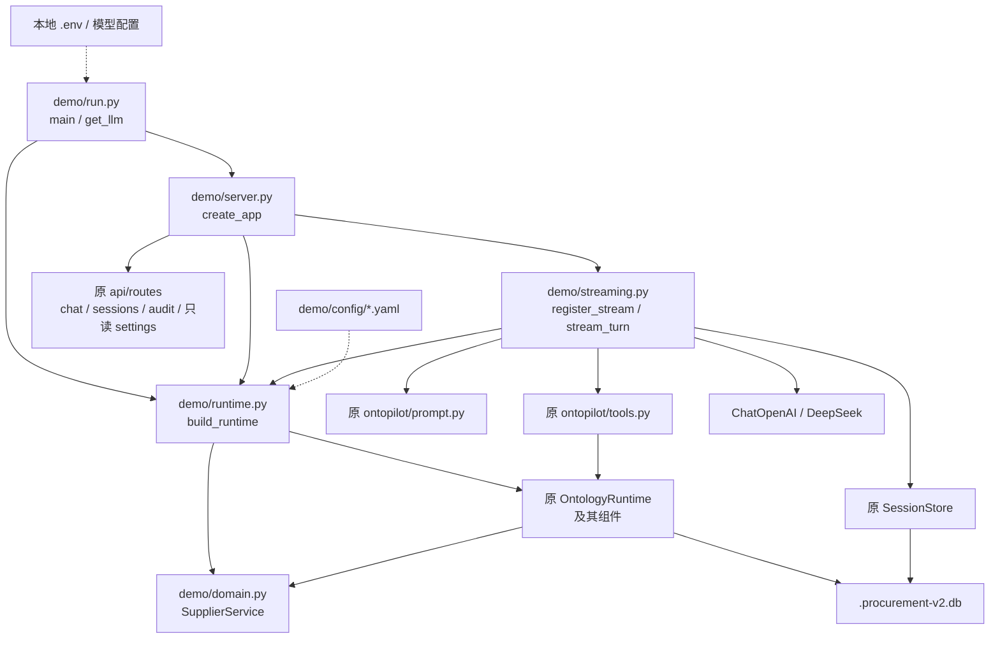
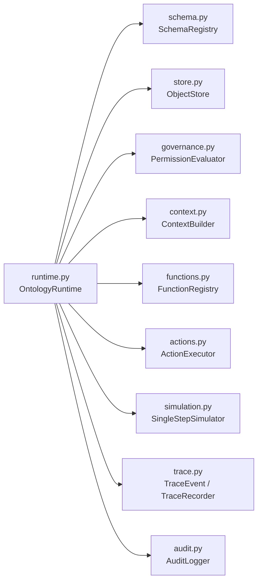
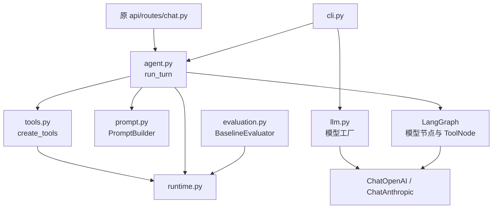
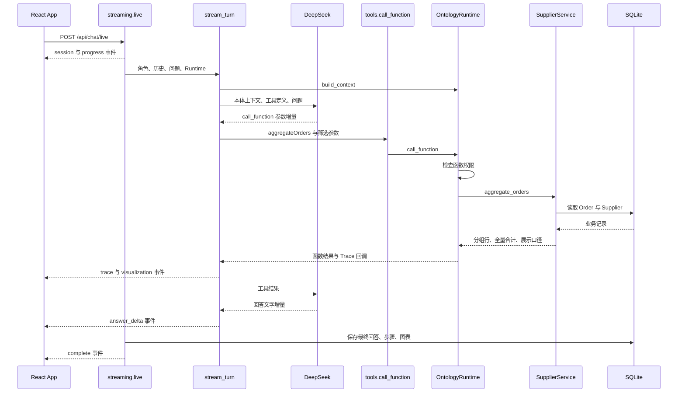
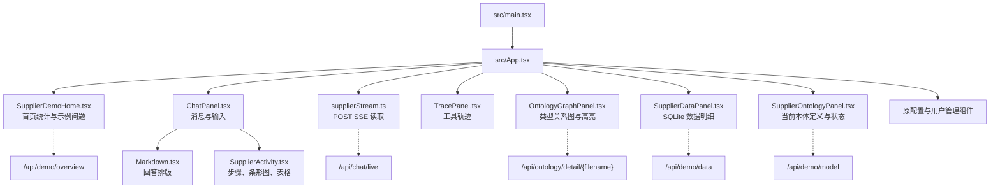
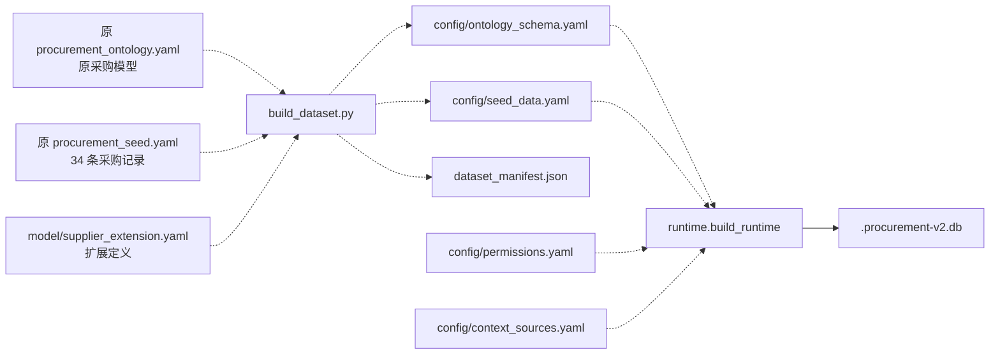

# OntoPilot 代码依赖图谱与阅读路线

核对日期：2026-10-15。按本地上游提交 `dc9ac375b979c7ea4fa95d209194f55b10f909f9` 和当前采购扩展代码整理。功能范围见 [功能说明](OntoPilot_功能说明.md)。

**建议先看当前采购 Demo 的一次问答，再向下读原 Runtime。** 这样能把每个文件对应到真实数据和页面行为。`repos/ontopilot/` 是原项目，`demo/ontopilot_supplier/` 是我们新增的业务实现与可复现适配层。

图使用 Mermaid；支持 Mermaid 的 Markdown 阅读器可以直接显示。每张图后附有文件说明，不支持图形渲染时也可以沿文字阅读。调用图中的实线表示调用或组装依赖，虚线表示配置、生成或数据流；不将它们混称为 Python import。

## 1. 先辨认目录和两个运行入口

```text
palantir/
├── repos/ontopilot/                 原开源项目克隆
│   ├── ontopilot/                   本体 Runtime、Agent、规则、权限、存储
│   ├── api/                         原 FastAPI 应用与路由
│   ├── frontend/                    原 React 应用；本机已应用采购界面适配
│   ├── config/                      原多场景 YAML 和教学数据
│   ├── tests/                       原项目测试与场景测试数据
│   ├── pyproject.toml               Python 依赖与 CLI 入口
│   └── uv.lock                      上游依赖锁
└── demo/ontopilot_supplier/          当前采购 Demo
    ├── run.py                       启动、模型配置、CLI
    ├── server.py                    当前 FastAPI 应用
    ├── streaming.py                 浏览器流式 Agent 与 POST SSE
    ├── inspection.py                本体状态与 SQLite 业务明细只读 API
    ├── runtime.py                   组装原 Runtime，接入采购函数与操作
    ├── domain.py                    采购计算、审批和事务
    ├── build_dataset.py             合并模型、生成数据、校验外键
    ├── prepare_frontend.py          将已跟踪的前端适配复制/应用到原前端
    ├── model/                       扩展定义与前端适配源文件
    ├── config/                      生成后的模型、数据、权限和上下文
    ├── test_*.py                    当前 Demo 的程序测试
    ├── smoke_live.py                原 Agent 的真实模型问答测试
    ├── smoke_stream.py              当前流式 HTTP 问答测试
    └── browser_smoke.mjs            Chrome 页面验证
```

| 运行方式 | 启动入口 | Agent 路径 |
|---|---|---|
| 当前采购网页 | `demo/ontopilot_supplier/run.py serve` → `server.create_app()` | `/api/chat/live` → `streaming.stream_turn()` |
| 当前采购兼容 API | 同上 | `/api/chat` → 原 `ontopilot.agent.run_turn()` |
| 当前采购单次命令行问答 | `run.py chat "问题"` | 原 `ontopilot.agent.run_turn()` |
| 原项目网页/API | 在原仓库启动 `uvicorn api.main:app` | `/api/chat` → 原 LangGraph Agent |
| 原项目 CLI | 安装包后的 `ontopilot chat` / `ontopilot run_case` | `ontopilot/cli.py` |

原仓库的 [main.py](repos/ontopilot/main.py) 只打印欢迎语，不能用来理解 FastAPI 启动过程。当前网页不走原 `api/main.py` 的应用初始化，而是复用它下面的一部分路由和核心库。

## 2. 当前采购 Demo 的代码调用图



图中 `demo/` 统一指 `demo/ontopilot_supplier/`。`Core → Domain` 表示 Runtime 通过已注册的函数或 SupplierActions 调用采购逻辑，不是原 Runtime 源码直接 import 我们的业务文件。

| 文件 | 主要入口 | 阅读时关注什么 |
|---|---|---|
| [run.py](demo/ontopilot_supplier/run.py) | main、load_env、get_llm | 如何设置原包导入路径、加载本地环境、创建模型并启动服务 |
| [server.py](demo/ontopilot_supplier/server.py) | create_app、lifespan、attach | 当前应用装配了哪些组件；哪些原路由复用、哪些管理写接口没有挂载 |
| [streaming.py](demo/ontopilot_supplier/streaming.py) | register_stream、stream_turn | 会话检查、SSE 队列、模型增量、工具调用、结果保存、出错处理 |
| [runtime.py](demo/ontopilot_supplier/runtime.py) | build_runtime、SupplierContext、SupplierActions | 原组件如何组装；`functions._fns.update` 如何注册业务函数；操作与上下文怎样扩展 |
| [domain.py](demo/ontopilot_supplier/domain.py) | SupplierService | 金额、影响、方案约束、聚合、审批和事务的真正实现 |

`build_runtime()` 不负责调用 LLM；`SupplierService` 也不依赖 LLM。网页对话的模型循环在 streaming.py，原兼容接口和 CLI 的模型循环在原 agent.py。

## 3. 原项目核心库的依赖图

### 3.1 Runtime 直接组装哪些组件

下面各模块均位于 `repos/ontopilot/ontopilot/`。这里画的是 runtime.py 中的核心导入与组装依赖。



当前采购扩展显式构造 Runtime，传入 SupplierContext 和 SupplierActions，且未传入仿真器。原 `OntologyRuntime.from_config()` 则会组装 SingleStepSimulator。这是“原框架有物流仿真、当前采购入口不使用它”的代码依据。

### 3.2 组件之间的具体依赖

| 模块 | 直接依赖的核心模块 | 负责什么 |
|---|---|---|
| [schema.py](repos/ontopilot/ontopilot/schema.py) | 无其他核心模块；读取 YAML | 将定义解析为对象、关系、函数和操作的数据结构 |
| [store.py](repos/ontopilot/ontopilot/store.py) | schema | SQLite 读写、查询、外键遍历、复制数据分支 |
| [governance.py](repos/ontopilot/ontopilot/governance.py) | 无其他核心模块；读取权限 YAML | 判断角色能查什么、调用什么、执行什么及确认要求 |
| [context.py](repos/ontopilot/ontopilot/context.py) | store、governance | 把上下文配置指定的业务记录组织为文本 |
| [functions.py](repos/ontopilot/ontopilot/functions.py) | schema、store | 注册并调用内置 Python 业务算法 |
| [actions.py](repos/ontopilot/ontopilot/actions.py) | schema、store、governance | 参数检查、预览、确认检查、创建或编辑对象 |
| [simulation.py](repos/ontopilot/ontopilot/simulation.py) | schema、store、functions | 在数据副本中比较物流运单方案 |
| [trace.py](repos/ontopilot/ontopilot/trace.py) | 无其他核心模块 | 内存记录本轮事件，转为前端可消费的字典 |
| [audit.py](repos/ontopilot/ontopilot/audit.py) | 无其他核心模块；使用 SQLite | 持久化审计记录并查询 |
| [runtime.py](repos/ontopilot/ontopilot/runtime.py) | 上述全部组件 | 对外提供统一查询、函数、操作、仿真入口并组织校验和记录 |

理解主干时，先看 Runtime 的公开方法：`query`、`traverse`、`call_function`、`preview_action`、`execute_action`、`simulate`。随后跟进被调用组件，不必一开始通读 functions.py 的所有行业算法。

### 3.3 Agent 在 Runtime 上面做什么



原 agent.py 用 LangGraph 循环执行模型与工具。tools.py 只把 Runtime 方法封装成模型能调用的工具，业务算法不写在这里。prompt.py 负责让模型知道业务定义、角色和调用规则；llm.py 负责模型配置适配。

`evaluation.py` 的 BaselineEvaluator 直接检查 Runtime 的确定性行为，其内置案例偏向物流，不能当作采购 Demo 的通用准确率报告。当前采购测试另有专门实现。

## 4. 跟着一次真实聚合问答看代码

以“受延期影响的销售订单按供应商汇总，展示图表和总计”为例。以下是调用顺序图，描述运行时数据流，不是静态 import 图。



按下面顺序跳转，可以看到每一层真正做了什么：

1. [App.tsx](repos/ontopilot/frontend/src/App.tsx) 的 `sendMessage`：采购模式分支创建助手消息，收到事件后更新文字、步骤和图表。
2. [supplierStream.ts 源文件](demo/ontopilot_supplier/model/supplierStream.ts)：fetch 读取响应流，按 SSE 帧解析，分辨完成、失败与连接中断。
3. [streaming.py](demo/ontopilot_supplier/streaming.py) 的 `register_stream`：建立/检查会话，拒绝同会话并发请求，准备事件队列。
4. 同文件的 `stream_turn`：构造提示词，调用 `model.astream`，合并模型的工具参数碎片，执行工具。
5. [tools.py](repos/ontopilot/ontopilot/tools.py) 的 `call_function`：把调用交给 Runtime。
6. [原 runtime.py](repos/ontopilot/ontopilot/runtime.py) 的 `call_function`：检查角色的函数权限，调用注册表，写审计和 Trace。
7. [Demo runtime.py](demo/ontopilot_supplier/runtime.py) 的注册映射：`aggregateOrders` 对应 `service.aggregate_orders`。
8. [domain.py](demo/ontopilot_supplier/domain.py) 的 `aggregate_orders`：检查分组白名单、筛选参数、口径，读取对象，用 Decimal 累加金额，排序并返回。
9. [SupplierActivity.tsx 源文件](demo/ontopilot_supplier/model/SupplierActivity.tsx)：直接把结果画成条形图与表格。

金额错误先看第 8 步及数据；工具选错先看第 4 步及函数描述；页面没逐步更新先看第 1—4 步。无需先改模型或重写整个 Agent。

## 5. 前端与流式事件的依赖关系



原 `useSSE.ts` 通过 GET `/api/chat/stream` 订阅 Trace，当前采购模式已经停用该订阅，改为使用同一条 POST 流返回所有事件。原模式仍保留 useSSE。

| 事件 | 后端发送内容 | 前端用途 |
|---|---|---|
| session | 会话 ID | 首次提问立即获得会话信息 |
| progress | 实际执行状态、工具名称及参数 | 显示加载上下文、执行工具、核对结果等步骤 |
| trace | 原 Runtime 事件 | 更新 Trace 面板与本体图高亮 |
| answer_delta | 模型公开回答文字增量 | 追加助手消息 |
| visualization | 聚合函数结果 | 显示条形图和明细表 |
| tool_result | 查询/函数真正返回给 Agent 的参数与完整结果 | 展开核对，并随历史保存 |
| complete | 最终回答、会话和确认状态 | 标记完成、更新历史和确认按钮 |
| error | 面向用户的失败提示 | 标明失败，避免把中断当作完成 |

前端采用固定组件渲染结构化结果，没有执行 LLM 生成的 JavaScript 或 SQL。界面管理组件存在，不代表当前服务器提供全部对应写接口；实际挂载范围以 server.py 为准。

## 6. 本体、数据和存储的生成依赖



[build_dataset.py](demo/ontopilot_supplier/build_dataset.py) 同时产出模型与数据，检查主键和关系目标。`dataset_manifest.json` 保存数量、来源、映射及数据摘要。

原生存储的 `objects` 表按对象类型和 ID 保存 JSON；关系主要存在对象的外键字段中，没有额外部署图数据库。业务对象、审计和会话在当前版本使用同一 SQLite 文件的不同表。

修改生成后的 ontology_schema.yaml 容易被下一次构建覆盖。新增采购能力应优先改扩展定义、业务实现和注册映射；权限、上下文也要匹配。重新生成 seed YAML 不会自动覆盖正在运行的业务数据库；`run.py reset` 才恢复教学业务数据，并保留会话与审计。

### 前端适配也有源文件与生成结果之分

| 可持续修改的源文件 | 应用后的运行文件 |
|---|---|
| `demo/ontopilot_supplier/model/SupplierDemoHome.tsx` | `repos/ontopilot/frontend/src/components/SupplierDemoHome.tsx` |
| `demo/ontopilot_supplier/model/SupplierActivity.tsx` | `repos/ontopilot/frontend/src/components/SupplierActivity.tsx` |
| `demo/ontopilot_supplier/model/supplierStream.ts` | `repos/ontopilot/frontend/src/supplierStream.ts` |
| `demo/ontopilot_supplier/model/stream_branch.txt` | 插入原 App.tsx 的采购流式分支 |
| `demo/ontopilot_supplier/prepare_frontend.py` | 对原组件、构建配置和类型声明应用适配 |

外层仓库忽略 `repos/`；只改克隆目录里的文件不能完整保存当前扩展。需要把改动落实到上述已跟踪源文件或适配脚本，再应用、构建。适配脚本支持在此上游版本首次执行和重复执行，遇到不匹配的上游文本会报错要求检查。

## 7. 操作、权限和事务看哪里

一次“执行已批准采购变更”的主要路径是：

```text
模型选择 execute_action
  → tools.execute_action
  → OntologyRuntime.execute_action（操作权限与记录）
  → SupplierActions.execute
  → SupplierService.execute
  → validate_action / _execute（角色、状态、审批人、指纹、约束）
  → SQLite 事务更新订单、选项、预算和申请
  → 返回结果，记录审计与 Trace
```

阅读 [domain.py](demo/ontopilot_supplier/domain.py) 时，把它分成三组：

| 分组 | 方法 | 主要依赖 |
|---|---|---|
| 查询与计算 | overview、assess_delay、assess_option、compare_options、trace_order、aggregate_orders、request_details | ObjectStore；其中方案评估复用延期计算 |
| 执行前校验 | validate_action | 查询申请/报价，重新评估方案和数据指纹 |
| 写操作 | execute、_execute | 校验、数据副本及 SQLite 事务 |

提交、审批、执行是三种不同 Action，不是一个函数自动完成全部流程。查询和方案比较不会触发写操作。上游通用权限和事务覆盖范围也不等同于当前采购专门实现；学习采购流程优先跟进 SupplierActions 和 SupplierService。

## 8. 外部技术依赖

版本声明以 [pyproject.toml](repos/ontopilot/pyproject.toml) 和 [frontend/package.json](repos/ontopilot/frontend/package.json) 为准；本机 Python 安装使用从上游锁文件导出的 [requirements.lock.txt](demo/ontopilot_supplier/requirements.lock.txt)。下面说明各依赖在代码中的职责，不表示每个包都被每条运行路径使用。

| 依赖 | 使用位置 | 用途 |
|---|---|---|
| Python 3.11+ | 核心库与后端 | 项目要求的 Python 版本范围；本机实际为 3.14.7 |
| PyYAML | schema、governance、context、数据构建、配置 | 读取/写入本体和业务配置 |
| sqlite3（标准库） | store、audit、sessions、采购事务 | 本地数据持久化 |
| langchain-core | tools、agent、streaming、消息模型 | 工具声明、消息和流式片段合并 |
| LangGraph | 原 agent.py | 模型节点、ToolNode、循环路由 |
| langchain-openai / langchain-anthropic | 模型工厂、Demo get_llm | 模型服务适配；当前 Demo 使用 ChatOpenAI 兼容 DeepSeek |
| FastAPI / Pydantic / Uvicorn | API | 路由、请求模型、应用服务 |
| httpx | 模型适配及测试相关路径 | HTTP 通信；验证脚本也使用它访问本机 API |
| sse-starlette / python-multipart | 上游声明的依赖 | SSE 相关生态及上传支持；当前自定义流直接使用 StreamingResponse |
| React / React DOM / TypeScript | 网页 | 页面、状态和类型检查 |
| Vite / Tailwind / PostCSS | 前端构建与样式 | 开发服务、打包、CSS |
| d3-force / d3-selection / d3-zoom | OntologyGraphPanel | 本体类型图布局、交互和缩放 |
| unittest / pytest / Playwright | 测试 | 规则验证、原测试套件、浏览器验证 |

当前部署不要求 Neo4j、向量数据库、Redis、消息中间件或 Palantir SDK。名称里有 Ontology 不意味着使用了图数据库或形式化推理器。

## 9. 建议按这个顺序读

| 顺序 | 文件 | 读完应能回答 |
|---|---|---|
| 1 | [Demo README](demo/ontopilot_supplier/README.md) 与 [数据清单](demo/ontopilot_supplier/dataset_manifest.json) | 在跑什么、有哪些业务对象和案例？ |
| 2 | [扩展定义](demo/ontopilot_supplier/model/supplier_extension.yaml) 与 [权限](demo/ontopilot_supplier/config/permissions.yaml) | 对象怎样关联，谁能调用哪些能力？ |
| 3 | [domain.py](demo/ontopilot_supplier/domain.py) | 影响、费用、约束和聚合具体怎么算？ |
| 4 | [Demo runtime.py](demo/ontopilot_supplier/runtime.py) | 业务代码怎样注册进原框架？ |
| 5 | [原 runtime.py](repos/ontopilot/ontopilot/runtime.py)、[store.py](repos/ontopilot/ontopilot/store.py)、[schema.py](repos/ontopilot/ontopilot/schema.py) | 本体定义怎样变成可查询和执行的能力？ |
| 6 | [tools.py](repos/ontopilot/ontopilot/tools.py)、[prompt.py](repos/ontopilot/ontopilot/prompt.py)、[streaming.py](demo/ontopilot_supplier/streaming.py) | 模型如何知道工具、选择工具并逐步返回结果？ |
| 7 | [server.py](demo/ontopilot_supplier/server.py) 与 [前端流读取](demo/ontopilot_supplier/model/supplierStream.ts) | 浏览器与后端如何交换状态和结果？ |
| 8 | [SupplierActivity.tsx](demo/ontopilot_supplier/model/SupplierActivity.tsx) 与 [App.tsx](repos/ontopilot/frontend/src/App.tsx) | 过程、文字、表格和图形如何显示？ |
| 9 | [test_domain.py](demo/ontopilot_supplier/test_domain.py)、[test_runtime.py](demo/ontopilot_supplier/test_runtime.py)、[test_streaming.py](demo/ontopilot_supplier/test_streaming.py) | 哪些规则和集成行为有测试依据？ |
| 10 | [原 agent.py](repos/ontopilot/ontopilot/agent.py)、[simulation.py](repos/ontopilot/ontopilot/simulation.py)、[原 README](repos/ontopilot/README.zh-CN.md) | 原通用框架还有哪些机制，与当前 Demo 有何差异？ |

### 要改某项功能，先找哪几个文件

| 目标 | 优先修改位置 |
|---|---|
| 增加/调整教学记录 | build_dataset.py → 重新生成 → 按需重置教学数据库 |
| 增加对象、属性、关系 | model/supplier_extension.yaml → build_dataset.py；检查种子与外键 |
| 增加业务函数 | 扩展 YAML → domain.py 实现 → runtime.py 注册 → permissions.yaml；按需补充上下文 |
| 改金额或可行性规则 | domain.py，对照 test_domain.py / test_runtime.py |
| 改风险评分算法 | 原 functions.py 的 _analyze_supply_risk；若要持续保存在扩展仓库，建立本地实现并注册替换 |
| 改 Agent 选工具习惯 | SupplierContext、函数描述、prompt、stream_turn；先确认是否为数据或算法问题 |
| 改流式进度或失败处理 | streaming.py、model/supplierStream.ts、model/stream_branch.txt |
| 改聚合图表 | model/SupplierActivity.tsx；如数据维度变化，再改 aggregate_orders |
| 改首页和示例问题 | model/SupplierDemoHome.tsx |
| 增加对外 API 或开放配置功能 | server.py；不要只改前端菜单 |

文档图谱依据源码静态阅读整理。当前功能验证的范围与原项目未运行的测试，见 [验证记录](demo/ontopilot_supplier/验证记录.md)，不能用模块依赖图代替功能验证。
