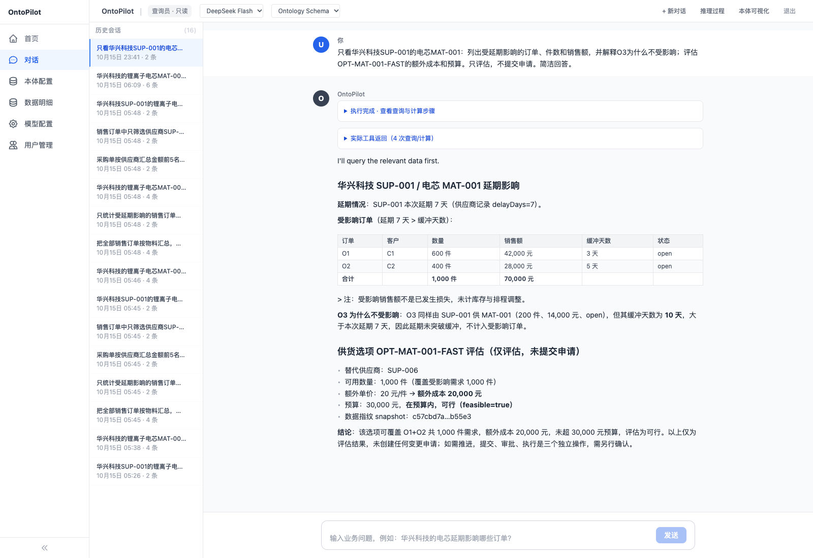

# Palantir 本体论入门：把分散资料变成能查询、能判断、能行动的业务地图

供应商说：“这批电芯要晚到 7 天。”你想知道：哪些客户订单会受影响？能不能换一家供应商？会多花多少钱？

回答这些问题，可能要同时翻采购表、客户订单、供应商通知和报价单。**Ontology 要做的，就是把这些资料对应到同一套业务事物和关系上，再接上计算与操作，让人和 AI 都能围绕它工作。**

本文按这个顺序讲，深度停在能看懂、能对照例子：

1. **本体是什么**：有哪些组成。
2. **企业数据怎样变成这张地图**：从公司里的表、PDF 到可查询的对象。
3. **AI 用在哪里**：哪些步骤交给模型，哪些仍由程序计算。
4. **Palantir 把这些做成了什么产品**：本体之外还有对话和业务页面。
5. **一个能对话的采购例子**：电芯延期之后怎么查、怎么算。
6. **在本机试一次**。

所有金额和订单都是虚构教学数据。

## 1. 本体是什么

Ontology 在这里译为“本体”，可以先理解成一张**有统一名称、关系和规则的业务地图**。这个比喻帮助理解，具体包括什么，要看实际业务系统。

把它的主要组成列出来，就容易理解了：

| 组成 | 是什么 | 采购例子 |
|---|---|---|
| **Object Type 对象类型** | 一类业务事物 | 供应商、物料、订单 |
| **Object 对象** | 某个具体事物 | 华兴科技这家供应商、O1 这张订单 |
| **Property 属性** | 事物的信息 | 供应商名称、订单数量、交货日期 |
| **Link 关系** | 事物之间的联系 | 订单要哪种物料，由哪家供应商供货 |
| **Logic / Function 逻辑与函数** | 用来计算和判断的规则或程序 | 算延期影响、比较替代成本、检查预算 |
| **Action 操作** | 按规定改变业务状态的能力 | 提交采购变更、批准申请、更新供货安排 |
| **Security 权限与安全** | 规定谁可以查看和操作，以及操作条件 | 采购员提交，审批员批准 |

“供应商”是一类事物，“华兴科技”是其中一家具体供应商。把“华兴科技供应电芯，电芯用于这些客户订单”连起来，才能从一家供应商查到相关订单。名称和口径也要统一，例如同一家供应商使用同一编号，销售金额与采购金额分开统计。

因此，在 Palantir 中，Ontology 既帮助理解业务，也为业务决策和执行提供共同基础。官方称它为组织的“运营层”，并说明它在许多场景下可以充当组织的数字孪生，也就是让数字模型对应现实中的事物及其变化。

*图中的采购业务是本文教学示例。*

## 2. 企业数据怎样变成这张地图

先想清楚要解决的问题，例如：“找出供应商延期的影响，并选择可行的替代供货方案。”这样就知道需要接入哪些资料。

接下来按 5 个阶段看数据怎样进入业务模型。这是本文采用的路线，便于看清分工；具体项目可以按数据来源调整。下面的供应商资料是教学示例。

**① 数据连接 → ② 原始存储 → ③ 清洗解析 → ④ 标准表格 → ⑤ Ontology 对象（Object / Link / Action）**

### 2.1 数据连接：把资料从源头接进来

连接公司已有的数据库、业务系统、接口或文件目录，取得采购表、供应商接口数据、PDF 通知和录音等资料。可以一次导入，也可以按配置持续同步。

这一阶段解决“资料从哪里来、怎样取得”，同时记录来源和同步信息。读取资料本身不要求修改源系统里的内容。

### 2.2 原始存储：先保留收到的原始资料

先把收到的原始表、JSON、PDF 或媒体文件保留下来，并记录来源、接入时间和版本。可以把这一层理解为“原件档案室”。

**后续清洗、识别和提取在下游生成结果，原始资料保留用于核对和重新处理。** 例如，从 PDF 提取出“延期 7 天”，并不会把原 PDF 改写成几个字段。Palantir 的推荐工程结构也将原始数据与下游加工结果分层管理。

### 2.3 清洗解析：按资料类型做不同处理

| 资料是什么样 | 先做什么 | 整理后能得到什么 |
|---|---|---|
| **表格数据：CSV、数据库表** | 读取行列，检查重复、空值、日期和金额单位，统一字段名称 | 一条条供应商、物料或订单记录 |
| **半结构化数据：JSON**，例如供应商接口返回的数据 | 按字段解析，把嵌套内容展开，提取编号、状态、交期等信息 | 能与订单表对应的字段 |
| **非结构化文档：PDF、扫描件**，例如延期通知或合同 | 提取已有文字；扫描件可用 OCR 识字，也可用视觉模型理解版面，再抽取业务信息 | 哪家供应商、哪种物料、预计晚几天，以及原文依据 |
| **媒体：图片、音频、视频**，例如到货照片或沟通录音 | 按任务选择图片识别、语音转写等处理方式 | 照片里的信息、录音内容或相关标注，并保留原文件 |

在 Palantir 中，**Pipeline Builder** 可以理解成可视化的数据加工流水线，用来解析、清洗和合并数据；**Media sets（媒体集）**用来管理 PDF、图片、音频等文件。

这里有个容易混淆的地方：**CSV 格式规整，不代表内容已经标准化。** 仍要确认“华兴”和“华兴科技”是否同一家、金额是元还是万元。官方也会把尚未解析、没有列定义的原始 CSV 归为半结构化输入；关键看数据当前是否已经有明确的结构，不能只看文件后缀。

**AIP 是 Palantir 把 AI 模型接入数据与业务流程的一组能力。** 它不只用于最后的对话，也可以参与前面的资料处理。一份供应商延期 PDF 可以这样处理：

1. 先读出文字。电子 PDF 可以直接提取，扫描 PDF 可以用 OCR；复杂版面也可选择视觉模型。
2. 再从内容中提取“供应商名称、物料编号、预计延期天数”。Pipeline Builder 中的 **Use LLM** 节点支持按设定的字段类型输出。
3. 检查结果是否正确、能否对应已有供应商和物料，确认后再用于业务。读出了几个字段，还不等于已经建好本体。

### 2.4 标准表格：整理成统一口径的行和列

把清洗和提取的结果整理成标准记录，统一名称、编号、日期、金额单位。例如，订单表写“华兴科技”，接口写 `SUP-001`，PDF 写“华兴”，核对后统一对应同一家供应商。

| 供应商编号 | 物料编号 | 延期天数 | 来源文件 | 原文位置 |
|---|---|---:|---|---|
| SUP-001 | MAT-001 | 7 | 华兴延期通知.pdf | 第 2 页 |

**标准表格既保存业务字段，也保留来源线索。** 例如原系统记录编号、文件引用、页码，以及使用的处理规则或模型版本，按需要一并关联保存。图片、音频等原文件仍可留在媒体集中，表格只保存文件引用和提取结果。

### 2.5 变成对象、关系和操作

把标准表格里的记录对应到第 1 节的组成：

- **Object：**用供应商编号识别“华兴科技”，用订单编号识别“O1”，把名称、数量、交期等字段映射成属性。
- **Link：**连接供应商、物料、客户订单和相关通知。打开供应商，就能继续找到它关联的订单与资料。
- **Action：**配置提交、审批、更新供货安排等业务操作，并接上计算规则与权限。

Object 和 Link 让数据可以按业务关系查询，Action 让决定能够按规则执行。Action 需要另外定义操作逻辑，表格解析后不会自动生成。

例如，定义“延期超过订单可容忍时间，就视为受影响”，比较替代方案时检查交期、数量和预算，再规定采购员提交、审批员批准。业务人员确认这些含义，技术人员再把它们实现出来。

### 2.6 为什么要分层：出错了能回到原件

**原始资料留存、加工结果另存、各阶段保留关联，是这条路线能逐层核对的原因。**

发现“SUP-001 延期 7 天”有疑问时，可以从业务对象找到标准记录，再查看提取过程，回到那份 PDF 的第 2 页核对。调整提取方法后，也可以用保留的原件重新处理。

Palantir 的 **Data Lineage（数据血缘）**用于查看数据从哪里来、经过哪些加工、流向哪些结果。具体到某条记录或 PDF 页码，还要在处理时保留对应的编号和引用。

这里“原始数据不受影响”，指清洗解析不覆盖原始资料，也不自动回写源系统。后面的 Action 会改变业务对象状态。如需写回公司原有系统，要另外配置接口和权限，并记录操作历史。

## 3. AI 用在哪里

AI 可以在多个环节帮忙，每个环节的职责不同：

| 环节 | AI 能帮什么 | 仍需要什么 |
|---|---|---|
| 整理资料 | 从通知中提取交期、从照片中识别信息、整理录音内容 | 检查提取质量，保留来源 |
| 建模与关联 | 辅助提出对象、字段和名称匹配的草案 | 业务人员确认含义与对应关系 |
| 对话与调查 | 理解问题，选择查询或计算工具，根据结果继续追问和解释 | 明确的业务定义、可用工具和访问权限 |
| 提出与执行方案 | 比较结果、提出建议，调用已授权的操作 | 程序检查预算、条件、权限和必要审批 |

导入资料后不会自动生成正确、完整的本体。金额加总、预算判断、审批检查这些明确规则，通常直接交给程序。

### 3.1 对话时，谁负责哪一步

使用 Palantir 内置方案时，**对话处理和工具调用由 AIP 的 Chatbot 承接，本体提供可查询的数据和可执行的操作。** 模型负责理解问题和选择工具。金额、权限和是否允许写入，仍由本体里的函数、Action 和安全规则决定。

例如用户说：“华兴科技的电芯改用那家能按时交货的备选供应商。”

| 步骤 | 由谁完成 |
|---|---|
| 接收消息和对话历史 | Palantir 的对话应用与服务 |
| 理解要改什么，选择工具和参数 | 所选用的大模型，依据配置的提示词与工具说明 |
| 查找供应商、物料和现有订单 | 配置给 Agent 的 **Object query** 工具 |
| 信息不全时追问 | Chatbot 的澄清工具或对话逻辑 |
| 计算额外成本、检查预算 | 配置给 Agent 的 **Function** |
| 执行修改 | 预先定义并开放给 Agent 的 **Action**；可以配置成自动执行，或经用户确认后执行 |
| 把执行结果写进后续回复 | Chatbot 的对话与工具调用流程 |

这些工具已经是产品里的能力，包括对象查询、函数、操作和澄清追问。不需要为了这一步从头写一套工具调用框架。业务含义仍要自己定：怎样算受影响、预算怎么卡、谁能提交、谁能批准。

## 4. Palantir 把这些做成了什么产品

第 1 节的本体，做在商业产品 **Foundry** 里。Foundry 是整套运营平台，数据接入、清洗流水线、本体、权限和应用都在其中。Pipeline Builder 负责第 2 节的数据加工；**Ontology Manager** 用来建立和维护对象、关系、函数与操作。AIP 把大模型接到这些数据和流程上。

**Palantir 提供的不只是本体构建。** 它把本体、对话 Agent 的配置与运行、聊天界面和业务应用搭建都做成了产品。可以在平台内走完这条流程，也可以只用它的本体，自己开发外部 Agent 和界面。Chatbot Studio 说明：助手可以在平台内部使用，也可以通过 Ontology SDK 和平台 API 对外提供。

| 你要做的事情 | 对应产品 | 它已经封装的部分 |
|---|---|---|
| 定义供应商、订单等对象，以及关系、可执行操作 | **Ontology / Ontology Manager** | 本体建模、把数据接到对象、定义查询和操作 |
| 配置对话 Agent | **AIP Chatbot Studio**（旧称 Agent Studio） | 选择模型、系统提示词、数据上下文和工具，再测试、发布 |
| 打开聊天窗口，与 Agent 对话 | **AIP Threads**，或 Studio 中的查看与测试 | Threads 可以选用已发布的 Chatbot；它同时是直接处理文档的通用对话工具 |
| 做“聊天 + 业务表格 + 按钮”的应用 | **Workshop** | 页面搭建，以及 AIP Chatbot 组件 |
| 使用自己开发的网页或程序 | **OSDK / 平台 API** | 接入本体和已发布 Chatbot 的接口 |

**Studio 是配置和发布 Agent 的地方。Threads 或 Workshop 是用户使用它的地方。** 走平台内这条路时，不需要先自己写一套前端，才有一个聊天窗口。

平台封装的是通用能力。一个“供应商延期助手”仍要自己决定：

- 供应商、物料、销售订单、采购单、供货选项和变更申请如何建模、如何关联。
- Agent 能看到哪些对象，能调用哪些函数和操作。
- “改用备选供应商”需要哪些参数，如何检查交期、数量、预算和权限。
- 哪些操作必须确认，失败后如何处理。
- 若要业务页面，怎样在 Workshop 中把聊天、订单列表和按钮放在一起。

Chatbot 入门指南要求配置数据上下文、工具、模型和系统提示词，再保存、测试、发布。已有 Foundry 账号时，可以先建一个对象类型和一个 Action，在 Chatbot Studio 接上查询与操作工具，用查看模式或 Threads 对话测试。需要聊天和业务数据放在同一页时，再搭 Workshop。

### 4.1 和本文后面的本地例子是什么关系

第 5 节的采购 Demo 使用同一类分工：本体定义对象和关系，程序负责计算与操作，模型只通过工具查询和调用。本地承接这些步骤的 Runtime 来自开源项目 OntoPilot，数据在本机 SQLite，对话使用 LangGraph 和一套自写的流式接口，页面是改过的 React。

这个 Runtime 是该开源项目自己的程序。两边能对照的是概念：对象、关系、函数、操作，以及按角色限制工具。官方文档没有给出可以在 Mac 上离线启动的 Foundry。本机可以编写连接托管实例的开发代码，对象和权限仍在 Palantir 那边。没有 Foundry 账号时，用第 5 节的本地 Demo 把同一条采购问题跑通。

## 5. 看一个能实际对话的例子

参考开源项目：https://github.com/jingw2/ontopilot，OntoPilot 定义业务对象、关系、计算能力和权限，再让 AI 通过工具使用它们，基于它做了本地采购 Demo，把前面的概念实际跑一遍。**没有用到palantir的产品，这是借用相似思路的开源教学实现。** 本地的 Runtime、SQLite 和当前网页，对应第 4 节里的 Ontology、Chatbot Studio，以及 Threads 或 Workshop。

当前 Demo 使用 DeepSeek，已有 8 家供应商、6 种物料、48 张客户销售订单、18 张采购单和候选报价等，共 170 条mock记录。

### 5.1 这套 Demo 对应前面的哪几步

| 第 2 节的阶段 | 当前 Demo 怎样体现 |
|---|---|
| 数据连接 | 使用开源项目已有文件和新增模拟数据，没有连接公司真实系统 |
| 原始存储 | 保留上游种子数据文件，加工时另生成教学数据 |
| 清洗解析 | 用程序合并记录、检查编号与关系；尚未处理 PDF 和媒体 |
| 标准表格 | 统一字段与编号；教学版使用预先准备的结构化记录，没有独立搭建标准表格层 |
| Ontology 对象 | 定义供应商、物料、订单等对象及关系，接上延期、成本、预算和审批能力 |

当前 Demo 的定义和数据是预先准备的，**尚未接入 CSV、JSON、PDF 或媒体的上传加工步骤** 本例重点展示对象、关系和计算已经就绪之后的效果：让 DeepSeek 调用这些工具，回答问题并解释依据。

### 5.2 电芯延期后怎么办

本段只看**华兴科技 SUP-001 的电芯 MAT-001**，不包含它供应的芯片，也不包含其他供应商。

华兴科技预计晚交货 **7 天**。先沿供应关系找到电芯对应的客户订单，再检查每张订单能容忍多久：

| 客户订单 | 数量 | 销售金额 | 可以容忍的延期 | 本次判断 |
|---|---:|---:|---:|---|
| O1 | 600 件 | 42,000 元 | 3 天 | 受影响 |
| O2 | 400 件 | 28,000 元 | 5 天 | 受影响 |
| O3 | 200 件 | 14,000 元 | 10 天 | 本次不受影响 |

上表选取 O1、O2、O3 作受影响与不受影响的对照，并非全部电芯订单。

因此，需要处理的是 O1、O2：共 **1,000 件，涉及销售金额 70,000 元**。这里的“涉及销售金额”表示受影响规模，不是已经发生的损失。

接着比较供货方案。有一家备选供应商能及时提供 1,000 件，每件多花 20 元，额外成本共 **20,000 元**，在 **30,000 元**预算内。其他报价即使更便宜，也可能因为数量不够、来不及交货或供应商不可用而被排除。

在这个过程中，**AI 理解问题、选择工具、解释结果；程序查关联、算金额、检查约束。** 如果决定采用方案，再进入提交、审批和确认执行。询问“哪种方案好”本身不会改变订单。

也不是每个问题都有可行答案。当前数据里，镜头物料没有全量准时替代方案；芯片物料虽然有货，但完整替代的最低额外成本为 32,000 元，超过预算。系统应该把这些限制说明白。

*这张截图对应上面的电芯案例，查询范围同为 SUP-001 与 MAT-001。可展开“实际工具返回”查看 Agent 真正收到的数据。*

### 5.3 还可以怎么问

除了逐张查订单，还可以直接做汇总和追问：

| 你可以问 | 当前初始数据下的结果 |
|---|---|
| “全部销售订单按物料汇总，展示金额排名和总计。” | 48 单，销售总额 883,250 元，并显示条形图和表格 |
| 接着问：“只看电芯 MAT-001，改为按客户汇总。” | 8 单，销售总额 119,000 元 |
| “只看受延期影响的销售订单，按供应商汇总。” | 8 单，涉及销售金额 277,000 元 |

**下面的汇总扩大到了所有供应商、所有物料，与上面的电芯案例范围不同。** 初始快照可这样核对：

| 范围 | 订单 | 受影响销售额 |
|---|---|---:|
| 华兴科技的电芯 | O1、O2 | 70,000 元 |
| 华兴科技的芯片 | O33、O34 | 90,000 元 |
| 华兴科技全部受影响 | 上述 4 单 | 160,000 元 |
| 所有供应商、所有物料受影响 | 共 8 单，另含东方精密和海威电子的订单 | 277,000 元 |

*这是全体受影响订单的供应商汇总：华兴科技 160,000 元、海威电子 63,000 元、东方精密 54,000 元，合计 277,000 元。数据为教学数据，图表使用程序的计算结果。*

对话会逐步输出回答，同时显示查询和计算步骤。重新打开历史会话，还能看到已保存的回答和聚合图表。采购变更执行后，结果会随本地数据变化。当前没有连接真实采购系统。

## 6. 在本机试一次

本机服务启动后访问 http://127.0.0.1:8000 ，选择查询员 `viewer`，密码 `demo123`。可以先点击首页问题，再试着追问：“为什么这张订单不受影响？”“预算减半还能换吗？”

左侧“本体配置”会显示后端已自动加载的采购本体，对话不需要手动激活。“数据明细”直接读取当前 SQLite，可切换对象、筛选记录、查看原始 JSON。点“电芯受影响”可以核对 O1、O2 和 70,000 元。对话中的“实际工具返回”保存本轮工具真正返回给 Agent 的参数和结果，可与数据明细对照。旧历史对话里没有保存的工具结果，不会事后补造。

如果要体验操作流程，采购员 `buyer` 负责提交和执行，审批员 `approver` 负责批准，密码同上。操作后端经过程序测试，并已在临时数据库中通过真实模型验证“采购员提交 → 审批员批准 → 采购员执行”。每一步仍由用户预览确认。各账号只查看自己的聊天记录，审批员通过共享申请编号处理业务。

需要安装、启动和代码阅读时，再看同目录下的三份说明，文件名如下：

- `demo/ontopilot_supplier/README.md`：安装、启动和验证方法。
- `demo/ontopilot_supplier/功能说明.md`：页面上的本体配置、数据明细、模型配置和三个账号能做什么。
- `OntoPilot_代码依赖图谱.md`：代码怎样组织、从哪里开始读。

本文的 Palantir 能力说明依据《资料来源》中的官方文档。供应商延期业务是教学设计。资料整理、对象关联、规则实现和实际系统接入，都需要相应的建设工作。
