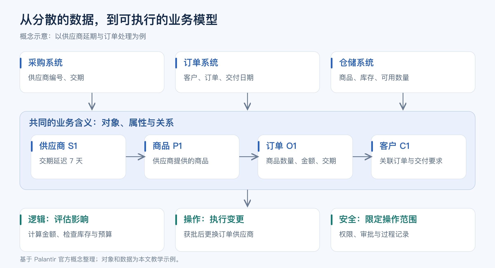
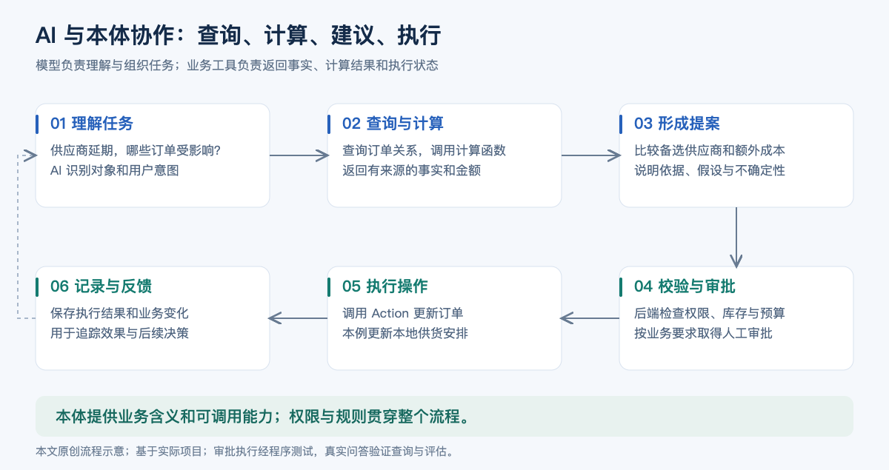
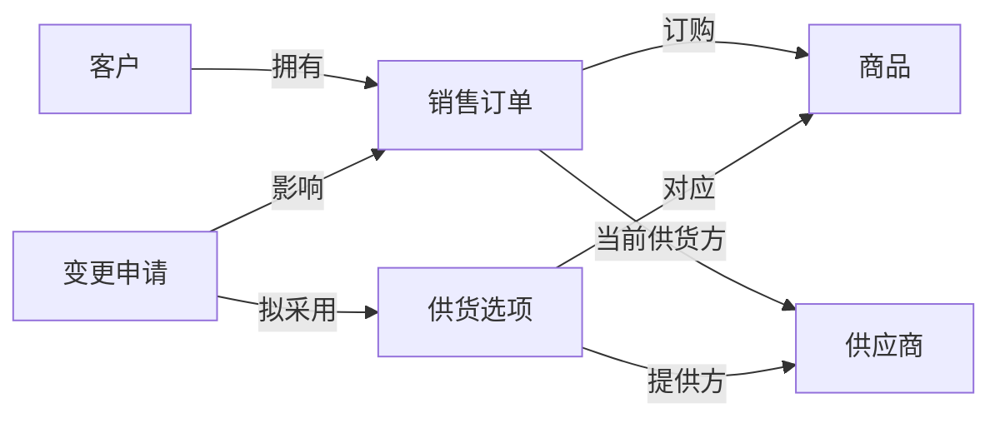
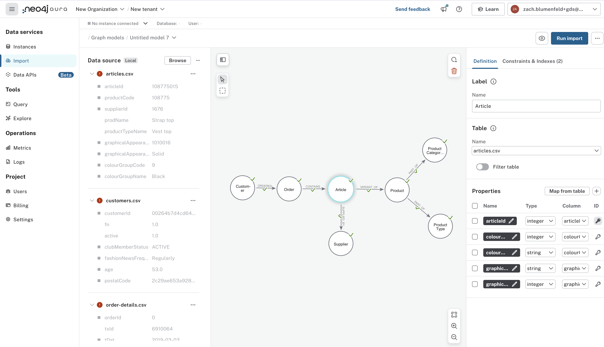

# Palantir 本体论：连接企业数据、AI 与业务行动

企业应用 AI 的难点，往往在于如何让模型准确理解业务，并在合适的权限下完成任务。订单、库存、合同和客户信息分散在不同系统中，名称和统计口径也可能不一致。模型需要知道这些数据代表什么、彼此如何关联，以及哪些操作可以执行。

**Palantir Ontology 为此提供了一层共同的业务模型：将数据组织为对象和关系，连接计算逻辑与可执行操作，供人员和 AI 使用。** 本文从基础概念、AI 协作方式和可实践案例三个方面介绍这一思路。产品能力以官方文档为依据，示意图和虚构数据另行标注。

## 1. 什么是本体

Ontology 在哲学中通常译为“本体论”，在计算机与知识工程中常译为“本体”。本文讨论的是后者：**对一个领域中的概念、属性、关系及其约束进行明确描述。** 

以采购业务为例，一套简单的本体可以包含：

| 要素 | 含义 | 例子 |
|---|---|---|
| 类型 | 一类业务事物 | 供应商、商品、订单、客户 |
| 对象 | 某个具体事物 | 供应商 S1、订单 O1 |
| 属性 | 事物的特征 | 交货日期、数量、金额 |
| 关系 | 事物之间的联系 | 供应商提供商品，订单属于客户 |
| 定义与约束 | 统一概念的含义和使用方式 | 订单金额按指定币种和含税口径记录 |

- 本体的作用不仅是给数据分类，也包括**统一业务含义**。例如，采购系统的“供应商甲”和财务系统的“甲公司”可能指向同一企业；“订单金额”和“已回款金额”则是不同指标。这些定义需要业务人员和技术人员共同确定，数据映射与实体匹配仍需实施工作。

- 可以把本体比作一张业务的**知识地图**：标明有哪些事物、它们如何关联，以及相关概念的含义和约束。在 Palantir 中，这张“地图”还连接计算逻辑和可执行操作。这个比喻用于帮助理解，并非官方定义，也不意味着本体本身就是保存全部业务数据的数据库。

- 区分**类型定义与对象事实**：“客户”类型及其属性是定义，“客户张三提交订单 O1”是对象事实。设计时可以将二者分层管理，但不能笼统地说“本体绝不包含对象”：OWL 可以表达个体及其事实；Palantir 也明确区分对象类型与实际对象，并支持查询和修改对象。可以用一张订单表辅助理解：整张表对应“订单”这一类型，一行对应一张具体订单，一列对应金额或日期等属性。关联客户编号，可以连接到客户对象。[Palantir：Core concepts](https://www.palantir.com/docs/foundry/ontology/core-concepts)

## 2. Palantir 如何使用本体

Palantir 将 Ontology 定义为组织的“运营层”：在已集成的数据与模型之上，建立与现实业务相对应的对象，并连接业务操作。官方区分了对象、属性、关系等语义要素，以及操作、函数和动态安全等支持业务运行的要素。

官方文档从以下几个角度描述它：

- **组织的数字孪生：**官方明确说，Ontology 在许多场景下充当组织的数字孪生。它将数字资产与现实中的设备、产品、订单和交易等相对应，同时包含语义要素和支持业务变化的操作能力。
- **统一数据、逻辑和操作的业务模型：**数据表达业务事实，逻辑支持判断，操作执行决策；安全与治理贯穿其中。官方完整框架还包括 Security。
- **人与 AI Agent 共用的业务交互基础：**官方将 Ontology 描述为人与 Agent 理解企业、调查变化和做出决策的接口。这里的“接口”指共同的业务表达和交互基础；具体可视化界面由上层应用提供。
- **以决策为中心的动态运营模型：**官方强调它随业务条件、目标和决策变化，并将执行结果反馈到后续决策中。实际更新速度和行动闭环取决于数据接入与工作流配置。



*图 1：依据官方概念绘制的中文示意图。供应商与订单为本文教学示例*

理解这一层，可以从四个方面入手：

| 组成 | 解决的问题 | 供应商延期场景 |
|---|---|---|
| 数据 Data | 当前发生了什么？ | 哪家供应商延期，关联哪些订单 |
| 逻辑 Logic | 如何评估和选择？ | 测算影响、检查库存、比较替代方案 |
| 操作 Action | 决策如何落地？ | 创建采购申请、修改订单供应商 |
| 安全 Security | 谁可以做什么？ | 检查访问权限、操作条件和审批要求 |

它们的共同目标，是让人员和 AI 围绕同一业务上下文查询、判断和行动。
便于记忆，也可以将上述内容概括为：**对象、关系、属性 + 业务逻辑 + 可执行操作 + 安全治理**。这是本文的组成概括，不是官方完整的形式化等式。
- Logic 包括函数、计算模型和业务规则： Function 是接收输入并返回计算或判断结果的程序逻辑；
- Action 按照预先定义的方式修改对象、属性或关系，也可触发配置好的外部操作。把订单与供应商关联起来，可以帮助定位风险；
- 连接函数与操作，才可以形成处理流程。向 ERP（管理采购、库存、财务等业务的企业资源计划系统）写入结果，需要对应的接口、权限和集成配置。

在产品体系中，Foundry 提供数据运营能力，Ontology 提供共同的业务表达和操作基础，AIP 将 AI 接入这些数据与流程。这是便于入门的分工概括，实际能力相互集成。

## 3. 与数据库、知识图谱和 RAG 的关系

这些概念关注的层面不同，可以在同一系统中组合使用。

| 概念 | 主要关注点 | 典型用途 |
|---|---|---|
| 数据库 | 数据的存储、查询与更新 | 保存订单和库存记录 |
| 本体 | 概念的含义、关系与约束 | 定义订单是什么、如何关联客户 |
| 知识图谱 | 用节点和连线组织实体、概念及关系 | 沿供应关系找到受影响的订单 |
| RAG | 检索信息后生成回答 | 找出合同交货条款，再回答问题 |
| Palantir Ontology | 将业务模型与逻辑、操作和治理集成 | 从定位风险到执行获批变更 |

在常见设计中，本体定义“有哪些类型和关系”，知识图谱承载“哪些具体事物存在这些关系”。两者可以结合，知识图谱也可服务于检索；不同文献对其边界有不同用法。RAG 是“检索增强生成”，即先查找相关信息，再让模型据此回答。Palantir 的助手可以使用对象、文档或函数提供的上下文，即回答时参考的业务信息。

本体尤其适合多个团队或系统需要统一概念、关系和数据口径的场景。若使用形式化公理与配套推理器，还可从已知事实推导隐含事实。例如，定义“采购订单是订单的一种”，便可将某张采购订单归入订单；这是基于已声明定义的逻辑推导，不能与 LLM 生成判断或自动发现新的现实规律混为一谈。

行业标准也需按用途区分：金融领域的 FIBO 是用 OWL 表达的业务本体，可参考其概念与关系；医疗领域的 FHIR 主要是卫生信息互操作标准框架，不能直接作为与 FIBO 同类的本体举例。统一口径的目标是使含义明确、差异可映射，不能简单理解为同一个词在所有业务情境下只能有一种含义。[FIBO 官方介绍](https://spec.edmcouncil.org/fibo/)、[HL7 FHIR 官方介绍](https://hl7.org/fhir/summary.html)

## 4. 本体如何与 AI Agent 协作

本文讨论的是基于大语言模型的 AI Agent（智能体）：能够围绕任务调用工具、根据结果继续处理的软件。大语言模型（LLM，即擅长理解和生成语言的模型）负责理解需求和组织任务，本体提供业务对象与关系，工具提供查询、计算和操作能力。这是本文场景下的工作分工，并非所有 Agent 都必须采用同一架构。

从 AI 的角度看，本体将**与任务有关的业务世界整理为模型可借助工具访问的结构化“地图”**。例如，回答“供应商 S1 延期影响哪些订单”，Agent 可以查询 S1，再沿关系找到订单，调用函数计算影响，并给出订单编号及计算依据。这使回答更容易有据可查、接受核对。实际机制是把对象定义、相关上下文和工具结果提供给模型，不是让模型一次性读入整张企业地图。[Palantir：Chatbot Studio Tools](https://www.palantir.com/docs/foundry/chatbot-studio/tools)

因此，本体能减少仅凭模型已有知识作答的情况，但不自动消除幻觉，也不能保证 Agent 一定查对数据或正确解释结果。



*图 2：Palantir 的对象查询、函数与 Action 工具能力整协作流程示意*

对于“供应商延期后如何处理订单”这一任务，合理的工作分工如下：

1. **理解任务：**模型识别供应商、时间范围和处理目标；名称不明确时请求澄清。
2. **获取事实：**通过本体查询关联订单、库存和交货要求，并保留数据来源。
3. **调用计算：**由函数测算受影响金额、替代采购成本和库存是否充足；预测、排产等问题可以调用相应模型。
4. **形成提案：**模型解释候选方案的依据、差异和假设。
5. **校验与执行：**后端验证权限和业务条件，按配置完成审批，再通过 Action 执行变更。
6. **反馈结果：**保存执行状态，并追踪交付是否改善。

官方工具文档支持对象查询、函数调用及 Action；操作可以配置为自动执行或用户确认后执行。因此，Agent 的自主程度取决于工具权限与流程配置。**“用户确认”与“业务审批”需要区分。** 聊天界面要求用户确认一次操作，不代表已经完成经理审批。审批人、预算限制等业务条件，需要在应用流程和操作规则中明确实现；Palantir 的操作提交条件可以用于约束哪些人、在什么条件下执行变更。

AI 也可以参与信息整理，例如从邮件中提取问题分类、结合已有业务对象生成建议。Palantir 的 AIP Logic 用于构建、测试和发布 LLM 驱动的函数；交互式助手由 AIP Chatbot Studio 等工具构建，后者在旧资料中称为 AIP Agent Studio。

## 5. 一个完整例子：供应商延期后的订单处理

假设O1、O2 是客户销售订单，金额为销售金额；每销售一件商品，就需要采购一件同规格商品。为突出原理，示例直接记录每张订单对应的供应商，省略独立采购单和订单明细。

| 项目 | 假设 |
|---|---|
| 原供应商 | 延迟交货 7 天 |
| 订单 O1 | 销售金额 60,000 元，对应采购需求 60 件，交付缓冲 3 天 |
| 订单 O2 | 销售金额 40,000 元，对应采购需求 40 件，交付缓冲 5 天 |
| 备选供应商 | 可及时提供同规格商品 100 个，每个增加成本 20 元 |
| 额外采购预算 | 3,000 元 |

“交付缓冲”指供应商比原计划晚到货后，仍能按时向客户交付的余量。假定本例中没有其他库存或排程调整可以吸收延期，7 天延迟便超过两张订单的缓冲。受影响销售订单金额为 **100,000 元**，替代采购额外成本为 **100 × 20 = 2,000 元**。在商品可完全替代的前提下，库存和预算条件均满足，可以提交更换供应商的提案。

若预算降至 1,000 元，方案应被规则拦截；若用户没有审批权限，也不能直接修改订单。审批通过后，操作更新订单并记录变更。

这里的 100,000 元是受影响订单规模，不等于已经发生或必然发生的损失。评价实际经济收益，还要考虑取消概率、交付延误、毛利、违约成本和实施费用。本体帮助形成更完整的决策依据，收益需要另行衡量。

配套的 [本地示例](demo/README.md) 已验证上述查询、计算、预算和审批流程。它采用规则模拟，没有调用大模型，适合先理解结构。

## 6. 如何从零构建：沿用供应商延期案例

为让下面的建模步骤可以对应到代码，本文增加了 [OntoPilot 供应商教学示例](demo/ontopilot_supplier/README.md)。它使用开源 OntoPilot 的 YAML 本体、SQLite 对象存储和 LangGraph Agent，分别定义对象、关系、计算与操作。它是对同一供应商场景的开源演示，不是 Palantir 产品或官方案例代码。目前业务规则测试与前端构建通过，Python 运行时接入及 DeepSeek 实际问答仍待验证。

### 官方有没有方法，有没有标准方案？

**有官方设计方法和实施教程，可以作为可复用的起点；具体业务模型仍需企业自己确定。** 官方《Ontology design: Best practices》强调按现实业务建模、跨团队协作、避免重复，并用真实业务问题验证设计；另有结构指南及对象、关系、操作的创建教程。[设计最佳实践](https://www.palantir.com/docs/foundry/ontology/ontology-best-practices)、[结构指南](https://www.palantir.com/docs/foundry/ontology/ontology-structural-guidance)

下面是依据官方能力和原则整理的**本文教学路线**，并非官方规定的固定六步法。它延续上一节的简化假设，先设计一个能处理供应商延期的最小范围，再逐步扩展。

### 第一步：确定要支持的业务问题

先由采购、销售和技术人员共同明确：哪家供应商延期？哪些客户订单受影响？备选供应商能否满足需求？额外成本是否在预算内？谁能批准变更？将这些问题作为设计输入，比只列出已有数据库表更容易发现业务缺口。

本例的交付目标是：能从 S1 找到 O1、O2，计算受影响金额和替代成本，提交变更，并在执行时检查预算与审批状态。这一范围与上一节的虚构数据对应。

### 第二步：定义对象、属性和关系

先写清业务含义，再决定数据字段如何映射。下表为本文设计的最小模型，英文名称仅为示例。

| 对象类型 | 关键属性 | 业务含义 |
|---|---|---|
| Supplier 供应商 | supplierId、名称、延期天数 | 一家可提供商品的企业 |
| Product 商品 | productId、名称、规格 | 可以采购和交付的商品 |
| Order 销售订单 | orderId、销售金额、需求数量、交付缓冲天数 | 本例限定每张订单只有一种商品，且全量由一家供应商供货 |
| Customer 客户 | customerId、名称 | 销售订单所属客户 |
| SupplyOption 供货选项 | optionId、可用数量、单件增量成本、能否及时交付 | 某供应商针对某商品的一项候选供货方案 |
| ChangeRequest 变更申请 | requestId、状态、审批人、审批时间 | 保存替换方案及其审批结果 |

关系包括：客户拥有多张订单；每张订单关联一个商品和当前供应商；供货选项分别关联供应商和商品；变更申请关联受影响的订单及拟采用的供货选项。SupplyOption 单独建模，是因为“可用 100 件、每件多 20 元”属于特定供货方案，不能一概当作供应商的固定属性。上述金额统一按人民币元、数量按件记录；正式项目还需明确税费和换算口径。



这张图展示类型之间的关系，不代表数量限制。正式业务若存在一单多商品、拆分供货或独立采购流程，应增加订单明细、采购单等对象，重新确定关系，不能直接照搬本例。官方同样强调对象应对应有业务意义的实体，避免机械地把源表和每一列原样搬进本体。

### 第三步：将真实数据映射到模型

为每种对象确定唯一标识、权威数据来源、字段含义和更新方式。例如，用订单系统的订单编号标识 Order，用客户主数据标识 Customer；同一供应商在不同系统中的编号需要先建立对应关系。检查缺失编号、重复对象、币种及更新时间，才能让“地图”对应现实。

在 Palantir 中，可在 Ontology Manager 中通过创建向导选择支撑数据源、配置属性映射、主键和显示名称，再设置对象安全策略；官方也提供通过 SuperRepo 进行代码化定义的路径。主键用于唯一识别对象，显示名称用于让人辨认对象。

随后创建关系类型，根据业务关系配置一对多或多对多等数量关系，并用外键、关联表等方式承载连接。例如，Order 的 customerId 应能关联到实际存在的 Customer，而不只是保存一串无法追溯的文字。

### 第四步：配置计算、操作与权限

本例可将能力拆为以下几项，避免把业务规则只写在提示词里：

| 能力 | 本例的输入和结果 |
|---|---|
| 影响评估函数 | 比较延期天数与订单缓冲，返回受影响订单、金额和需求数量 |
| 替代测算函数 | 检查商品匹配、可用数量及交付条件，计算需求数量 × 单件增量成本 |
| 提交变更申请 | 保存具体订单、供货选项和测算结果，状态设为待审批 |
| 审批申请 | 校验审批权限并记录结果；方案改变后需重新审批 |
| 执行变更 | 重新校验预算、供货条件及批准状态，再更新关联订单并记录执行结果 |

这些函数和操作是教学设计。在 Palantir 中需分别实现函数、Action 和应用审批流程；只创建对象关系不会自动生成完整审批系统。官方 Action 入门教程展示了如何更新对象属性并配置提交条件，本例是在这些机制之上设计业务流程。

### 第五步：向人与 Agent 提供可用入口

人员通过业务应用查询和审批；Agent 则配置对象查询、函数和 Action 工具。为对象和工具补充清晰的名称、说明、参数及权限，让 Agent 知道“什么可查、如何计算、什么可执行”。工具配置必须与后端权限一致。例如，查询助手可以读取订单并测算，审批权限则按业务角色单独配置。

### 第六步：用业务问题验收并持续维护

让没有参与建模的业务人员与 Agent 分别完成第一步的问题，核对查找路径、结果和依据。官方明确区分结构检查与任务验证：图画得合理，仍需检验使用者能否实际完成调查和决策。

本文教学验收应至少覆盖：S1 延期 7 天时能找到 O1、O2；金额汇总为 100,000 元、替代增量成本为 2,000 元；预算 1,000 元时不能执行；未审批或无权限时不能变更；供货选项数量不足时不能沿用旧结论。还需核对数据更新后查询是否变化，以及变更记录能否对应到实际订单。

完成这一轮设计，应留下业务问题清单、对象与关系定义、数据映射表、函数与操作说明、权限审批规则及验收记录。原有 `demo/demo.py` 是上一节的规则模拟；新增的 OntoPilot 示例对应本节模型，其验证范围另行列明，二者都未在 Palantir 环境部署验证。

### 将构建步骤对应到开源 Demo

新增的 `demo/ontopilot_supplier/` 将上述设计拆成可阅读的文件：

| 构建内容 | 对应文件与实现 |
|---|---|
| 定义类型、属性和关系 | `config/ontology_schema.yaml`：Supplier、Product、Customer、Order、SupplyOption、ChangeRequest，另加 Policy 保存教学预算 |
| 填充对象与建立关联 | `config/seed_data.yaml`：O1 的 customerId 为 C1；Order.customer 用这个外键关联客户对象 |
| 查询与测算 | `domain.py`：按延期天数与缓冲判断影响，计算成本并检查商品、数量、交付和预算；`traceOrderRelations` 实际沿订单关系查询 |
| 操作与权限 | `config/permissions.yaml` 与 `domain.py`：采购员提交、审批员审批、采购员执行，后端重新检查业务条件 |
| 连接 Agent | `runtime.py` 注册业务函数与操作，`run.py` 复用上游 Agent，将查询和计算结果交给 DeepSeek |
| 验收 | 规则单测、SQLite 集成测试、`smoke_live.py` 的真实模型问答与工具轨迹检查 |

在这套实现中，**YAML 负责声明有哪些能力，Python 负责实现能力如何运行**。例如，定义 `assessSupplyOption` 并不会自动获得成本计算程序，需要注册对应函数。关系也需明确字段映射，例如：

```yaml
# Order 类型下的关系定义
links:
  customer: {target: Customer, foreign_key: customerId}
```

为检验规则是否真正区分风险，Demo 增加了销售订单 O3：缓冲 10 天，不受 S1 的 7 天延期影响。O1、O2 仍应合计为 100,000 元和 100 件，替代成本仍为 2,000 元。这里的数值是教学数据与规则的预期结果，不是已经取得的模型回答。

可用“沿 O1 的关系找出客户、商品与供应商”“S1 延期影响哪些订单”“OPT-S2-P1 能否覆盖需求，预算降到 1,000 元会怎样”等问题验收。安装、命令、角色及各项验证状态见 [Demo 说明](demo/ontopilot_supplier/README.md)。当前已通过 9 项独立业务规则测试；SQLite Runtime 接入和真实 Agent 问答尚受 Python 依赖安装权限阻碍，未宣称已跑通。

## 7. 公开企业案例

### Airbus Skywise：连接航空数据与维护决策

Airbus 于 2017 年宣布与 Palantir 合作推出 Skywise。2019 年关于 United Airlines 的公告进一步介绍了预测性维护、机器学习能力，以及 Skywise 与 Foundry 的连接。该案例说明，将分散的运营数据组织起来，可以支持航空维护与可靠性管理。[Airbus 2017 年公告](https://www.airbus.com/en/newsroom/press-releases/2017-06-airbus-launches-skywise-aviations-open-data-platform)、[Airbus 2019 年公告](https://www.airbus.com/en/newsroom/press-releases/2019-06-airbus-partners-with-united-airlines-to-manage-aircraft-data-and)

这是一项早于本轮生成式 AI 热潮的应用，不能直接视为 LLM Agent 案例；公告也未披露完整客户本体和可复现代码。

### Tyson Foods：把 AI 代码迁移纳入验证与反馈流程

2024 年 AIPCon 的案例材料介绍了 Tyson 将旧平台 ACE 的数据处理代码迁移到 dbt（数据转换工具）的工作流。AI 参考已批准的代码转换结果生成新代码，随后进行语法与编译检查、人工复核，再送入 GitLab 代码管理平台。它将模型生成、验证和执行连接成一个流程。[Palantir：Tyson 案例材料](https://www.palantir.com/assets/xrfr7uokpv1b/5GVfxqOkUJ3ZaOGza5G7nM/4257c0eb78ce1a765f5efb25d6f6844a/AIPCon_US_Sep_24_-_Demo_Expo_-_Tyson.pdf)

该资料由厂商发布，可用于了解工作机制；其中的效率说法不宜直接推广为其他企业的预期收益。

## 8. 可实践的开源项目

### OntoPilot：与本文供应商案例直接对应

[OntoPilot](https://github.com/jingw2/ontopilot) 提供 YAML 本体、业务函数、权限、操作、审计与 Agent 的开源框架。本文新增的 [供应商 Demo](demo/ontopilot_supplier/README.md) 优先用它连接第 6 节的设计；它采用 SQLite，不需要另外准备 Neo4j。上游已克隆、前端已构建；本例规则测试通过，Python 后端与模型问答仍待完成验证。

### Neo4j Customer Graph：本体与 Agent 的开源参考

Neo4j 的 [graphrag-examples](https://github.com/neo4j-product-examples/graphrag-examples) 包含客户与零售分析示例：使用本体文件描述业务结构，结合结构化数据和文档构建图，再由 Agent 调用检索与分析工具。[Neo4j 官方教程](https://neo4j.com/developer/genai-ecosystem/customer-graph-agent/)



*图 3：Neo4j 官方示例仓库的原始配图。Customer（客户）连接 Order（订单），订单连接商品，商品关联 Supplier（供应商）。这不是 Palantir 界面，也不是本次运行截图。[图片原始位置](https://github.com/neo4j-product-examples/graphrag-examples/blob/a1d4c114698079e9760094b5205920e4b7a85eed/customer-graph/img/struct-ingest-2-see-model.png)*

该项目适合学习“领域定义—数据关联—Agent 工具调用”，主要展示分析问答。本体文件和关键代码已下载到当前文件夹；运行仍需 Neo4j 与模型服务配置。

### Palantir OSDK 与社区案例：原生平台参考

[AIP Community Registry](https://github.com/palantir/aip-community-registry) 收录了社区贡献项目，其中 Python OSDK Hello World 适合入门，演示从本体读取对象。[osdk-ts](https://github.com/palantir/osdk-ts) 则提供官方 TypeScript 开发工具。OSDK 是应用访问本体的工具包，使用时仍需要自己的 Foundry/AIP 环境、认证与权限。

| 路线 | 当前文件 | 适合学习 | 本次验证状态 |
|---|---|---|---|
| 本地规则示例 | `demo/` | 对象、计算、审批和留痕 | 已运行验证，无 LLM |
| OntoPilot 供应商示例 | `demo/ontopilot_supplier/`、`repos/ontopilot/` | 本体定义、关系、计算和 Agent | 规则测试及前端构建通过，后端与真实问答待验证 |
| Neo4j Agent | `repos/graphrag-examples/` | 本体与图检索、Agent 工具 | 已克隆和检查，未端到端运行 |
| Palantir 社区案例 | `repos/aip-community-registry/` | 原生平台的对象与 SDK | 已克隆，未在平台部署 |

具体命令与环境要求见 [实践指南](实践指南.md)。SDK 指软件开发工具包；下载 SDK 和社区案例不等于下载了完整平台，它们不包含一套可在本地独立运行的 Foundry/AIP 后端。

Palantir 本体论的实用价值，在于将业务概念、数据关系、计算能力和受控操作连接起来。对于企业 Agent，这提供了理解业务和调用工具的基础；最终效果仍取决于数据质量、流程设计与执行可靠性。

---

**资料与图片说明：**正文链接指向原始来源，完整索引见 [资料来源](资料来源.md)，图片归属见 [配图说明](assets/README.md)。用户提供的 [知乎参考文章](https://zhuanlan.zhihu.com/p/1968630511132991727) 本次未能读取正文及图片，因此暂未作逐条对比，也未把其中内容作为事实依据。
