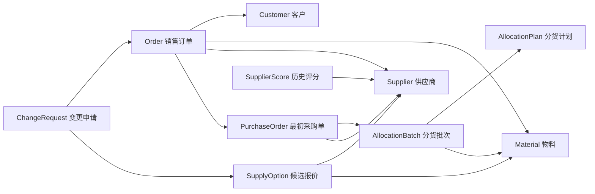
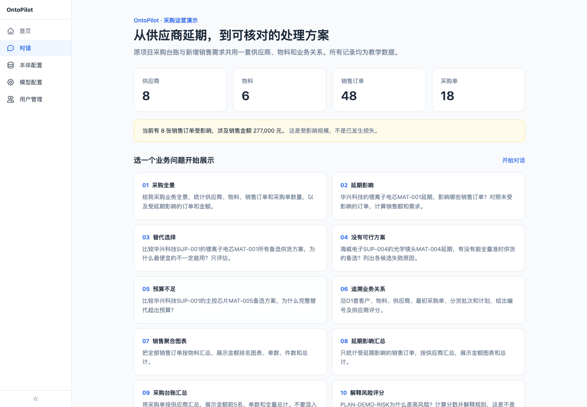
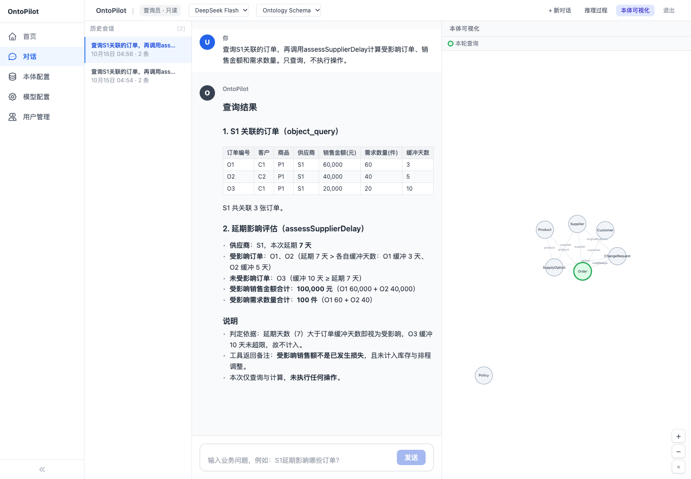

# Palantir 本体论：连接企业数据、AI 与业务行动

企业应用 AI 的难点，往往在于如何让模型准确理解业务，并在合适的权限下完成任务。订单、库存、合同和客户信息分散在不同系统中，名称和统计口径也可能不一致。模型需要知道这些数据代表什么、彼此如何关联，以及哪些操作可以执行。

**Palantir Ontology 为此提供了一层共同的业务模型：将数据组织为对象和关系，连接计算逻辑与可执行操作，供人员和 AI 使用。** 本文从基础概念、AI 协作方式和可实践案例三个方面介绍这一思路。产品能力以官方文档为依据。全文业务案例统一使用本地可对话的 OntoPilot 采购项目：合并原项目采购台账和新增教学数据，不是 Palantir 官方案例或企业真实数据。

## 1. 什么是本体

Ontology 在哲学中通常译为“本体论”，在计算机与知识工程中常译为“本体”。本文讨论的是后者：**对一个领域中的概念、属性、关系及其约束进行明确描述。** 

以采购业务为例，一套简单的本体可以包含：

| 要素 | 含义 | 例子 |
|---|---|---|
| 类型 | 一类业务事物 | 供应商、物料、销售订单、客户 |
| 对象 | 某个具体事物 | 华兴科技 SUP-001、销售订单 O1 |
| 属性 | 事物的特征 | 交货日期、数量、金额 |
| 关系 | 事物之间的联系 | 订单 O1 关联物料 MAT-001 和客户 C1 |
| 定义与约束 | 统一概念的含义和使用方式 | 销售金额与采购金额分开，金额统一为人民币元 |

- 本体的作用不仅是给数据分类，也包括**统一业务含义**。本项目将两份数据统一到 SUP-001 等供应商编号和 MAT-001 等物料编号；客户销售订单 Order 与采购单 PurchaseOrder 则分开建模，不能混加两类金额。这些定义需要业务人员和技术人员共同确定，数据映射与实体匹配仍需实施工作。

- 可以把本体比作一张业务的**知识地图**：标明有哪些事物、它们如何关联，以及相关概念的含义和约束。在 Palantir 中，这张“地图”还连接计算逻辑和可执行操作。这个比喻用于帮助理解，并非官方定义，也不意味着本体本身就是保存全部业务数据的数据库。

- 区分**类型定义与对象事实**：“客户”类型及其属性是定义，“客户 C1 对应销售订单 O1”是对象事实。设计时可以将二者分层管理，但不能笼统地说“本体绝不包含对象”：OWL 可以表达个体及其事实；Palantir 也明确区分对象类型与实际对象，并支持查询和修改对象。可以用一张订单表辅助理解：整张表对应“订单”这一类型，一行对应一张具体订单，一列对应金额或日期等属性。关联客户编号，可以连接到客户对象。[Palantir：Core concepts](https://www.palantir.com/docs/foundry/ontology/core-concepts)

## 2. Palantir 如何使用本体

Palantir 将 Ontology 定义为组织的“运营层”：在已集成的数据与模型之上，建立与现实业务相对应的对象，并连接业务操作。官方区分了对象、属性、关系等语义要素，以及操作、函数和动态安全等支持业务运行的要素。

官方文档从以下几个角度描述它：

- **组织的数字孪生：**官方明确说，Ontology 在许多场景下充当组织的数字孪生。它将数字资产与现实中的设备、产品、订单和交易等相对应，同时包含语义要素和支持业务变化的操作能力。
- **统一数据、逻辑和操作的业务模型：**数据表达业务事实，逻辑支持判断，操作执行决策；安全与治理贯穿其中。官方完整框架还包括 Security。
- **人与 AI Agent 共用的业务交互基础：**官方将 Ontology 描述为人与 Agent 理解企业、调查变化和做出决策的接口。这里的“接口”指共同的业务表达和交互基础；具体可视化界面由上层应用提供。
- **以决策为中心的动态运营模型：**官方强调它随业务条件、目标和决策变化，并将执行结果反馈到后续决策中。实际更新速度和行动闭环取决于数据接入与工作流配置。


*图 1：依据官方概念绘制的中文示意图。供应商与订单为本文教学示例*

理解这一层，可以从四个方面入手：

| 组成 | 解决的问题 | 供应商延期场景 |
|---|---|---|
| 数据 Data | 当前发生了什么？ | 哪家供应商延期，关联哪些订单 |
| 逻辑 Logic | 如何评估和选择？ | 测算影响、检查库存、比较替代方案 |
| 操作 Action | 决策如何落地？ | 创建采购申请、修改订单供应商 |
| 安全 Security | 谁可以做什么？ | 检查访问权限、操作条件和审批要求 |

它们的共同目标，是让人员和 AI 围绕同一业务上下文查询、判断和行动。
便于记忆，也可以将上述内容概括为：**对象、关系、属性 + 业务逻辑 + 可执行操作 + 安全治理**。这是本文的组成概括，不是官方完整的形式化等式。
- Logic 包括函数、计算模型和业务规则： Function 是接收输入并返回计算或判断结果的程序逻辑；
- Action 按照预先定义的方式修改对象、属性或关系，也可触发配置好的外部操作。把订单与供应商关联起来，可以帮助定位风险；
- 连接函数与操作，才可以形成处理流程。向 ERP（管理采购、库存、财务等业务的企业资源计划系统）写入结果，需要对应的接口、权限和集成配置。

在产品体系中，Foundry 提供数据运营能力，Ontology 提供共同的业务表达和操作基础，AIP 将 AI 接入这些数据与流程。这是便于入门的分工概括，实际能力相互集成。

## 3. 与数据库、知识图谱和 RAG 的关系

这些概念关注的层面不同，可以在同一系统中组合使用。

| 概念 | 主要关注点 | 典型用途 |
|---|---|---|
| 数据库 | 数据的存储、查询与更新 | 保存订单和库存记录 |
| 本体 | 概念的含义、关系与约束 | 定义订单是什么、如何关联客户 |
| 知识图谱 | 用节点和连线组织实体、概念及关系 | 沿供应关系找到受影响的订单 |
| RAG | 检索信息后生成回答 | 本项目未接入文档 RAG，实际使用结构化工具查询 |
| Palantir Ontology | 将业务模型与逻辑、操作和治理集成 | 从定位风险到执行获批变更 |

在常见设计中，本体定义“有哪些类型和关系”，知识图谱承载“哪些具体事物存在这些关系”。两者可以结合，知识图谱也可服务于检索；不同文献对其边界有不同用法。RAG 是“检索增强生成”，即先查找相关信息，再让模型据此回答。Palantir 的助手可以使用对象、文档或函数提供的上下文，即回答时参考的业务信息。

本体尤其适合多个团队或系统需要统一概念、关系和数据口径的场景。本项目通过外键建立关系、通过 Python 函数执行规则，没有使用 OWL 推理器，也没有因为使用 LLM 就自动获得形式化推理能力。

## 4. 在这套业务系统中，哪里用到了 AI

**本体不是 AI 模型，构建和使用本体也不一定需要 AI。** 将供应商、物料和订单定义清楚，接好外键，计算金额，检查预算，以及按批准结果更新订单，都可以由常规程序完成。没有 LLM，这套数据和规则仍可以通过代码或表单使用。

本项目实际使用 DeepSeek 的地方是 **Agent 运行时**：理解用户问题，识别业务对象，选择工具和参数，根据工具结果继续查询，最后解释方案与依据。它不只是把固定查询结果换一种说法；它会根据问题组织不同的调查路径，但计算和校验由已实现的工具承担。

| 环节 | AI 可以做什么 | 本项目实际实现 |
|---|---|---|
| 构建本体 | 从业务说明中提出对象、属性、关系和字段映射草案，辅助生成代码与测试 | 定义预先编写在 YAML 中，由程序检查；没有自动建模功能，语义仍需人审定 |
| 接入业务数据 | 从邮件、合同或 PDF 中抽取供货信息，辅助名称匹配与异常识别 | 用确定性脚本合并现有记录并生成 mock 数据；没有用 LLM 抽取业务文档 |
| 预测与判断 | 用专门的机器学习模型预测延误、需求或质量，再将结果连接到本体 | 没有训练预测模型；延期天数是教学快照，风险分数是固定规则 |
| 对话与任务组织 | 理解问题、查找对象、选择函数、跨关系追溯、比较结果并解释 | **已实现：真实 DeepSeek Agent 调用查询、关系与业务函数** |
| 执行动作 | Agent 可以提出或调用已授权的操作，协助组织流程 | 操作后端实现提交、审批和执行；权限、预算及审批状态由程序检查，真实对话验证以查询和评估为主 |
| 反馈与改进 | 汇总审计、辅助复盘和生成评测问题；有专门流程时也可用于模型改进 | 保存对话、工具轨迹和操作审计，没有自动训练或自我学习流程 |

Palantir 官方文档分别介绍了人与 Agent 共用数据、逻辑、操作和安全的方式，文档提取能力，以及将 AI/ML 模型接入运营流程的能力。这支持上述扩展方向，但不表示当前 Demo 已实现所有能力。[Why create an Ontology?](https://www.palantir.com/docs/foundry/ontology/why-ontology)、[Document Intelligence](https://www.palantir.com/docs/foundry/document-intelligence/overview)、[Models in the Ontology](https://www.palantir.com/docs/foundry/ontology/models)

以“华兴科技的电芯延期影响哪些订单，换哪家供应商合适”为例，实际分工是：

1. **AI 理解问题：**识别华兴科技、锂离子电芯和“评估而非直接执行”的意图。
2. **工具查事实：**查询 Supplier、Material、Order；按照预先定义的关系查客户与采购来源。
3. **函数算结果：**比较延期与交付缓冲，汇总金额与数量，逐个检查候选供货方案。
4. **AI 组织解释：**把“便宜但交期不满足”“数量不够”“预算超出”等结果解释给用户，保留对象编号和依据。
5. **后端控制变更：**只有进入申请、审批和确认执行流程，才修改供货安排。


*图 2：本项目的教学协作流程。AI 负责理解与组织任务，业务程序负责计算、校验和写入；图中的操作闭环经过程序测试，不能等同于已经验证 Agent 自主审批。*

**规则评分、优化算法和 AI 需要分清。** 本项目 `analyzeSupplyRisk` 给出的 85 分，来自固定规则加分，不是模型预测的 85% 违约概率；`compareSupplyOptions` 是约束检查后按成本排序，不是 AI 求出的全局最优采购方案。AI 的价值在于让人更容易提出问题、追溯原因和理解取舍。

## 5. 贯穿案例：一套能实际对话的采购业务

### 数据怎么合并

原 OntoPilot 采购示例包含 6 种物料、5 家供应商、3 个分货计划、8 个批次、5 张采购单和 7 条评分，共 34 条记录。本项目保留这些记录的原编号和原字段，将原先 S1/P1 的小例子统一到 SUP-001/MAT-001，再新增客户、销售需求、供货报价和几种异常情境。不是把两个互不相连的例子放在一起。

| 业务对象 | 当前数量 | 作用 |
|---|---:|---|
| Supplier 供应商 | 8 | 供货状态、能力、质量与交付表现 |
| Material 物料 | 6 | 电芯、显示屏、外壳、镜头、芯片、纸箱；含库存与预留 |
| Customer 客户 | 12 | 关联销售需求 |
| Order 销售订单 | 48 | 含待交付、已完成和不同交付缓冲的对照 |
| AllocationPlan / AllocationBatch | 10 / 21 | 分货计划与按供应商分配的批次 |
| PurchaseOrder 采购单 | 18 | 保存采购数量、采购价格和批次来源 |
| SupplierScore 评分 | 10 | 保留历史供应商评价 |
| SupplyOption 供货选项 | 36 | 按原供应商和物料记录候选报价、数量、交期 |
| Policy / ChangeRequest | 1 / 初始 0 | 预算策略与运行中产生的变更申请 |

共 170 条初始记录，覆盖 11 种对象。固定教学快照为 **2026-07-01**，不是实时外部数据。`dataOrigin` 区分上游记录与本轮 mock；上游记录新增的延期、库存预留等假设单独列在 [数据清单](demo/ontopilot_supplier/dataset_manifest.json)。上游本身也是教学数据，不能因为记录来自开源项目就称为真实企业数据。

本例将物料按原规格直接转售，一张销售订单只包含一种物料，不引入生产装配模型。销售金额与采购金额分开；库存的“总量”和“可挪用量”也分开。风险物料的当前库存已全部预留，所以不能看到有库存就判断本轮需求已解决；本例尚不做跨订单库存分摊或排产优化。

### 情境一：电芯有可行替代方案

华兴科技 SUP-001 本轮预计延期 7 天。先限定锂离子电芯 MAT-001，再检查销售订单：

| 销售订单 | 数量 | 销售金额 | 交付缓冲 | 结果 |
|---|---:|---:|---:|---|
| O1 | 600 件 | 42,000 元 | 3 天 | 受影响 |
| O2 | 400 件 | 28,000 元 | 5 天 | 受影响 |
| O3 | 200 件 | 14,000 元 | 10 天 | 本次不受影响 |

受影响需求为 **1,000 件**，对应销售金额 **70,000 元**。南湾电源 SUP-006 的 `OPT-MAT-001-FAST` 可及时供 1,000 件，每件比原供货方案增加 20 元，额外成本为 **20,000 元**，在 **30,000 元**预算内。

更便宜的选项可能交期不满足、数量不足，或供应商已停供；另有可行但更贵的选项。因此，展示重点是“逐项排除不可行条件，再解释取舍”，不是只看谁最便宜。把预算收紧为 10,000 元时，原本可行的 20,000 元方案也应被拦截。受影响销售金额不等于已经发生的损失。

华兴科技同时供应主控芯片 MAT-005，所以问“华兴科技整体影响”时还应得到芯片影响；问“电芯影响”时则不能把芯片件数加进电芯替代报价。

### 情境二：不同物料有不同结论

| 情境 | 可以直接提的问题 | 确定性函数给出的结果 |
|---|---|---|
| 显示屏可替代 | 东方精密的 MAT-002 延期，哪些候选可用？ | 受影响需求 400 件，首个可行选项增量成本 4,800 元 |
| 镜头没有完整可行方案 | 海威电子的 MAT-004 延期，为什么不能直接换供应商？ | 需要 300 件；候选分别存在交期、数量或状态问题，没有可全量准时替代的方案 |
| 芯片预算不足 | 华兴科技的 MAT-005 有货可替代，为什么仍不能执行？ | 需要 200 件；可全量准时供货的最低增量成本 32,000 元，高于 30,000 元预算 |
| 分货计划风险 | PLAN-DEMO-RISK 为什么是高风险？ | 单一供应商 50 分、计划占该供应商月产能超过 80% 加 20 分、历史交付表现偏低加 15 分，共 85 分 |

这些问题使用同一套供应商、物料和采购关系，不需要切换到其他行业案例。当前全局有 **8 张销售订单受延期影响，涉及销售金额 277,000 元**；这是初始快照结果，执行变更后会变化。

## 6. 如何构建这套本体与关系

### 官方有没有方法，有没有标准方案

官方提供设计原则、结构指南、创建教程和验证方法。可以复用方法，但具体对象、业务口径和审批规则需要按场景确定。官方强调按真实业务含义建模、跨团队协作、避免重复，再用真实业务问题验证可用性。[设计最佳实践](https://www.palantir.com/docs/foundry/ontology/ontology-best-practices)、[结构指南](https://www.palantir.com/docs/foundry/ontology/ontology-structural-guidance)、[验证方法](https://www.palantir.com/docs/foundry/ontology/ontology-design-validation)

以下是本文项目的实际路线，不是官方规定的固定六步法，也不要求先用 AI 自动生成本体。

### 第一步：先定业务问题

需要回答的是：哪些销售需求受影响、采购来源在哪里、哪些备选能覆盖需求、哪些被预算或交期拦截、谁可以批准变更。以这些问题确定范围，而不是先把所有数据都画进一张大图。

### 第二步：统一对象与编号

复用原项目的 Supplier、Material、AllocationPlan、AllocationBatch、PurchaseOrder、SupplierScore，增加 Customer、Order、SupplyOption、ChangeRequest 和 Policy。旧小例子的供应商与商品编号映射到统一编号，不再维护另一套 S1/P1 数据。

供应商的历史交付表现与“本次延期天数”是不同属性；某份报价的可用数量和增量成本属于 SupplyOption，不是供应商永远不变的能力。`sourceSupplierId` 指明报价相对哪家原供应商计算增量，避免把相对价格当成通用价格。

### 第三步：用外键建立可追溯关系



图用于阅读主要业务关系，实际定义在 `config/ontology_schema.yaml`。例如，Order 的 `originalPurchaseOrderId` 关联采购单，采购单的 `batchId` 再关联分货批次。Agent 可调用 `traceOrderRelations`，从 O1 查到客户 C1、物料 MAT-001、供应商 SUP-001、采购单 PO-DEMO-001-1 和计划 PLAN-DEMO-001。

```yaml
# Order 类型中的一条实际关系
links:
  originalPurchaseOrder:
    target: PurchaseOrder
    foreign_key: originalPurchaseOrderId
```

`build_dataset.py` 校验主键重复及关系目标是否存在，再产出模型和数据。记录导入 SQLite 后，查询才会沿这些编号找到实际对象。画了连线、写了名称，不代表已经把数据关联好。

### 第四步：实现函数、操作与权限

| 能力 | 本项目实现 | AI 是否负责计算或校验 |
|---|---|---|
| 业务概览 | getProcurementOverview | 否，程序统计 |
| 分组聚合与展示 | aggregateOrders，按供应商、物料、客户或状态汇总 | 否，程序汇总，界面展示图表；AI 选择分组与筛选 |
| 延期影响 | assessSupplierDelay，支持按物料筛选与分组 | 否，比较缓冲并汇总 |
| 替代评估与比较 | assessSupplyOption / compareSupplyOptions | 否，检查物料、报价基准、数量、交期、状态和预算 |
| 关系追溯 | traceOrderRelations | 否，按外键查询；AI 决定何时调用 |
| 采购风险评分 | analyzeSupplyRisk，复用上游函数 | 否，按固定规则加分 |
| 申请、审批、执行 | submit / approve / executeSupplierChange | 否，后端检查角色、批准状态、数据变化和用户确认 |

**YAML 声明能力，Python 实现能力。** 只写一个函数名不会自动得到正确的业务算法。查询员可查询与评估；采购员提交申请和执行获批变更；另一位审批员批准。执行前重新核对数据指纹，订单、报价或预算变化就要求重新提交。

执行会更新受影响销售订单的供货安排，扣减候选可用数量与预算，记录审计；原采购单作为历史来源保留。当前没有自动创建新的正式采购单或写入 ERP，不应把本地变更当成现实采购已经完成。SQLite 事务保证本例多订单写入失败时回滚。

### 第五步：把业务定义和工具接给 Agent

`runtime.py` 加载模型、数据、权限与函数；`run.py` 连接 DeepSeek。用户用自然语言问问题，模型选择对象查询或业务函数。这里才实际发生线上 LLM 调用，建表、导入数据、计算成本和检查审批都不依赖 LLM。

### 第六步：分别验收程序和 AI

程序测试检查原项目记录是否完整保留、跨物料是否隔离、预算和审批是否拦截、执行是否持久化、失败是否回滚。真实模型测试检查 Agent 是否调用正确工具、是否引用实际对象、是否能解释失败原因；不能只看“回复了一段话”。

本轮已通过 **19 项程序测试、原 7 组真实模型对话、新增 6 组流式对话和 Chrome 页面验证**。真实对话覆盖查询和评估，操作闭环由程序及 SQLite 测试覆盖，不等同于已验证自主采购审批。

## 7. 怎样展示这个项目

服务启动后访问 **http://127.0.0.1:8000**。选择查询员，密码 `demo123`。首页展示当前业务数量和影响规模，提供可直接点击的演示问题；进入对话后可同时打开本体图，查看工具轨迹。对话会实时显示加载本体、执行查询或计算、组织回答等状态，并逐步输出文字；这些是实际执行进度，不是模型完整的内部思维链。

建议按“全景 → 追溯 → 影响 → 方案 → 失败原因”展示：

1. “给我采购业务全景，有多少供应商、销售订单和采购单？”
2. “沿 O1 查到客户、物料、最初采购单、分货批次与计划，并看供应商评分。”
3. “华兴科技的电芯 MAT-001 延期影响哪些销售订单？为什么 O3 不受影响？”
4. “比较这批电芯所有备选方案，为什么最便宜的不一定能用？”
5. “镜头 MAT-004 为什么没有全量准时替代方案？芯片 MAT-005 为什么有货仍超预算？”
6. “PLAN-DEMO-RISK 的 85 分怎么来的？这是 AI 预测吗？”

还可以展示“从汇总到追问”：

- “全部销售订单按物料汇总，展示金额排名、单数、件数与总计。”初始快照为 48 单、883,250 元。
- 接着问：“只看 MAT-001，改为按客户汇总。”得到 8 单、119,000 元。
- “受延期影响的销售订单按供应商汇总。”得到 8 单、277,000 元，并显示条形图和明细表。
- “采购单按供应商展示金额前 5 名，给出全量合计。”全量为 18 单、2,222,000 元，展示前 5 组；它与销售额分别统计。

这些数字由 `aggregateOrders` 计算，图表直接使用函数返回的数据。AI 理解“按什么分组、筛选哪些记录”，不承担加总；Top N 截取展示行，全量总计另外保留。当前只支持上述固定维度及等值筛选，没有任意报表或 SQL 生成功能。




*图 3：合并数据后的本地展示首页，统计来自实际 Runtime。*



*图 4：真实 DeepSeek 工具问答；数据为教学数据，界面不是 Palantir 官方产品。*

## 8. 实践文件与使用边界

| 文件 | 学什么 |
|---|---|
| [Demo 说明](demo/ontopilot_supplier/README.md) | 安装、运行与验证命令 |
| [数据清单](demo/ontopilot_supplier/dataset_manifest.json) | 数量、来源、旧编号映射和 mock 字段 |
| `demo/ontopilot_supplier/model/supplier_extension.yaml` | 新增对象、关系、函数和操作的源定义 |
| `demo/ontopilot_supplier/build_dataset.py` | 合并原项目模型、保留原记录并生成教学数据 |
| `demo/ontopilot_supplier/config/` | 实际加载的定义、对象数据、权限与模型配置 |
| `demo/ontopilot_supplier/domain.py` | 影响、成本、约束与审批的确定性实现 |
| [真实问答摘录](demo/ontopilot_supplier/问答验证摘录.md) | 已运行问题及实际工具轨迹 |
| [验证记录](demo/ontopilot_supplier/验证记录.md) | 已验证范围与尚未实现的能力 |

本文只用这一个开源项目贯穿教学；原来的规则小脚本与其他仓库保留作历史参考，不再混作本文案例。OntoPilot 是开源教学实现，不能代替 Palantir Foundry/AIP，也不证明 Palantir 内部采用同样架构。本地角色与确认机制未作为生产身份认证审计，当前没有文档 RAG、需求预测、全局排产或自动学习功能。

**资料与配图：**官方依据见 [资料来源](资料来源.md)，图片归属见 [配图说明](assets/README.md)。
