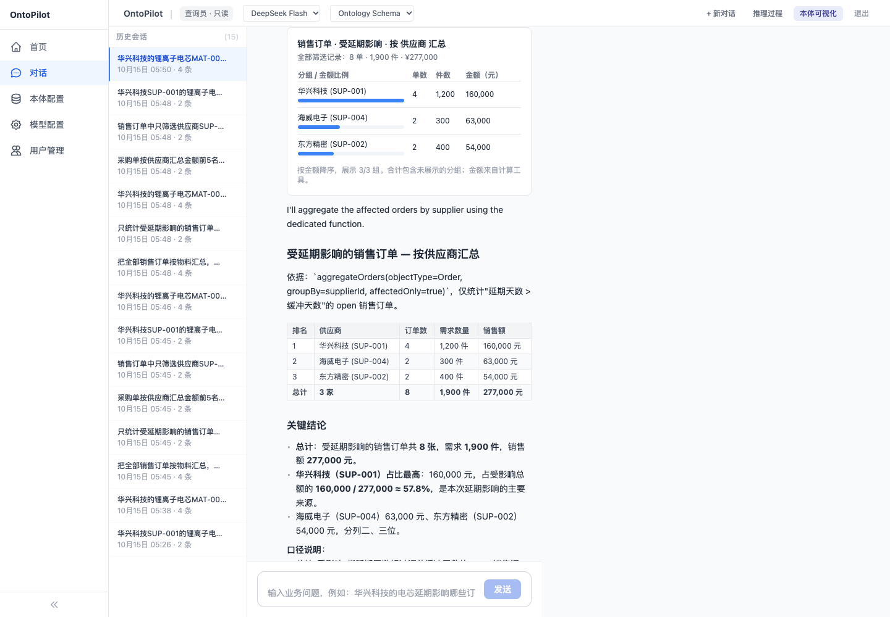

# 流式问答验证摘录

真实调用 DeepSeek `deepseek-v4-flash`，模型非思考模式；数据均为教学数据。各问题均经 HTTP 流式入口验证，并与确定性函数结果比对。耗时仅代表本机本次请求。

| 问题 | 首个文字增量 / 完成（秒） | 文字增量数 | 已核对结果 |
|---|---|---|---|
| 把全部销售订单按物料汇总，展示金额排名图表、单数、件数和全量总计。 | 1.106 / 3.607 | 388 | Order · 48 单 · 10,450 件 · 883,250 元 · 展示 6/6 组 |
| 在刚才销售订单的口径下，只看MAT-001，改为按客户汇总，给出图表与总计。 | 0.458 / 3.576 | 456 | Order · 8 单 · 1,700 件 · 119,000 元 · 展示 8/8 组 |
| 只统计受延期影响的销售订单，按供应商汇总，展示金额图表和全量总计。 | 0.749 / 3.343 | 321 | Order · 8 单 · 1,900 件 · 277,000 元 · 展示 3/3 组 |
| 采购单按供应商汇总金额前5名，展示图表、单数和全量合计，不要混入销售订单。 | 0.824 / 3.884 | 433 | PurchaseOrder · 18 单 · 29,880 件 · 2,222,000 元 · 展示 5/6 组 |
| 销售订单中只筛选供应商SUP-999，按物料汇总，展示图表和总计。不存在就如实说明，不要切换到其他供应商。 | 0.679 / 2.473 | 202 | Order · 0 单 · 0 件 · 0 元 · 展示 0/0 组 |
| 华兴科技SUP-001的锂离子电芯MAT-001延期，影响哪些销售订单？对照未受影响订单，计算销售额和需求。 | 0.552 / 5.991 | 708 | Order · 8 单 · 1,700 件 · 119,000 元 · 展示 2/2 组 |

每次均先收到会话与进度事件，再收到多个文字增量，最后收到完成事件。`sales-followup` 沿用前一问题会话；Top 5 的总计仍覆盖全部分组。空结果没有补造记录。步骤、图表和回答均已核查保存至会话。

浏览器另外验证首次请求尚未完成时已显示进度，以及后续聚合图表显示 277,000 元。程序测试覆盖碎片化工具参数、增量输出、聚合口径及失败处理；未进行长时间并发或完整真实模型审批验证。

