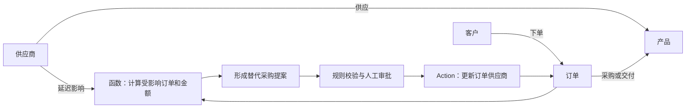

# Palantir 本体论：让 AI 看懂业务，并把建议变成行动

> 用途：面向非技术听众的分享讲稿。建议讲述 20—25 分钟，另留 5 分钟演示。正文可以直接朗读，“演示提示”不必念出。  
> 研究日期：2026 年 10 月 13 日。产品名称按本次检索到的官方文档记录。  
> 阅读约定：标明来源的内容为公开资料；“教学例子”“我的判断”属于作者解释；本地演示中的公司、订单和金额均为虚构。

## 一、开场：为什么企业买了 AI，却仍然很难让它办事？

大家好，今天我们聊一个听起来很抽象、实际很贴近业务的词：本体论，英文叫 Ontology。

我们先想象一个场景。一家制造企业收到消息：关键供应商要晚交货一周。老板问：“哪些客户订单会受影响？涉及多少钱？能不能找其他供应商？谁有权批准？”

这些问题看起来只有四句话，但答案可能分散在采购系统、客户系统、库存表和财务表里。即使 AI 很会写文章，它也需要先知道：这家供应商对应哪些产品，产品对应哪些订单，订单对应哪些客户，以及公司允许它做哪些操作。

今天我们就围绕这件事，回答三个问题：什么是本体论？它怎样与 AI 配合？我们怎样自己动手做一个小例子？

## 二、基础：本体论可以理解成一套共同的业务语言

“本体论”原本是哲学中的一个概念。到了计算机领域，我们可以先把它理解成：明确一个领域里有哪些事物、它们有哪些特征、彼此有什么关系，以及相关定义和约束。

比如在采购业务里，“供应商”是一类事物，“供应商甲”是一个具体对象；交货周期是它的属性；“供应商甲供应零件乙”是一个关系。W3C 的 OWL 标准也通过类、属性和具体实例来表达领域知识。不过，理解今天的内容不需要先学 OWL 语法。[来源：W3C《OWL Guide》](https://www.w3.org/TR/owl-guide/)

我们可以用一个教学例子记住它：

| 概念 | 通俗解释 | 企业里的例子 |
|---|---|---|
| 对象类型 | 某一类业务事物 | 客户、订单、供应商 |
| 对象 | 某一件具体事物 | 订单 O1 |
| 属性 | 这件事物的特征 | 金额 6 万元、数量 60 |
| 关系 | 事物之间的联系 | 客户甲下了订单 O1 |
| 规则 | 业务判断条件 | 额外采购成本不能超预算 |

这里最容易忽略的是“统一含义”。采购系统把一家企业叫“供应商甲”，财务系统把它叫“甲公司”，我们需要知道它们是不是同一个主体。销售额、回款额、利润也不能混成一个指标。建立本体时，业务人员必须参与定义这些口径。

以上表格和例子是教学解释。它想表达的是：本体首先帮助人和机器在同一套业务含义下工作。

## 三、Palantir 的 Ontology 多做了什么？

Palantir 把 Ontology 定义为组织的运营层：把平台中的数据和模型连接到现实业务事物。官方文档既包含对象、属性和关系，也包含操作、函数与安全治理。[来源：Palantir Ontology 概览](https://www.palantir.com/docs/foundry/ontology/overview)

所以，讲 Palantir 本体论时，我们还要补充两个词。

第一个是 Function，也就是函数。可以把它理解成一个负责计算或判断的工具。例如：计算受影响订单金额、预测需求、检查替代供应商的库存。

第二个是 Action，也就是操作。例如：创建采购申请、更新订单供应商、提交工单。它把业务决定变成系统中的变化。是否能执行，需要满足相应权限和条件；连接外部系统时还需要配置集成，不能认为建好对象就会自动改动 ERP。[来源：Palantir 平台概览，Actions 部分](https://www.palantir.com/docs/foundry/platform-overview/overview/index.html)

我们用一张图来看今天的教学场景：



图里从供应商走到客户，是在理解业务关系；从提案走到订单更新，是在执行业务流程。这两部分结合起来，才接近我们今天讨论的 Palantir 思路。

顺便辨认三个名称：Foundry 主要提供数据运营能力，Ontology 提供业务对象、逻辑和操作的共同表达，AIP 则把 AI 接入这些数据与业务流程。实际产品能力相互集成，这只是方便入门的分工记忆。[来源：Palantir AIP 概览](https://www.palantir.com/docs/foundry/aip/overview)

### 它和数据库、知识图谱、RAG 有什么区别？

下面是帮助理解的教学比较，不是产品能力的绝对边界。

| 概念 | 主要帮我们回答什么 | 供应商场景中的用途 |
|---|---|---|
| 数据库 | 数据如何存储和查询？ | 保存订单、价格、供应商编号 |
| 知识图谱 | 哪些事物相互关联？ | 找出供应商连接的产品和订单 |
| RAG | 回答前如何找到相关资料？ | 找出合同中的交货条款 |
| Palantir Ontology | 如何用业务对象、逻辑和操作支持决策？ | 查询订单、测算影响、执行获批变更 |

RAG 是“检索增强生成”，可以简单理解成先查资料再回答。知识图谱也可以接操作系统，数据库也可以支撑复杂流程，它们不是互相排斥的选择。本体也不要求一定使用图数据库：本次本地示例只用 Python 和 JSON，就能说明基本关系。

我们不要把 Palantir Ontology 简化成“一张图”，也不要把所有知识图谱项目都叫作 Palantir 的替代品。

## 四、AI 怎样应用在本体论里面？

回到刚才的问题：“供应商晚交货一周，怎么办？”我们把一个合理的 AI 工作流程拆成六步。下面的流程是教学设计。

**第一步，理解问题。** 大语言模型，也就是 LLM，理解用户说的供应商名称、延期时间和关注目标。如果有两家同名公司，先澄清。

**第二步，查询业务对象。** 系统按当前用户的权限，找到对应供应商，再沿着关系找到相关订单。这里查询的是业务数据，而不是让模型凭记忆猜公司的订单情况。

**第三步，调用工具计算。** 根据交货时间判断哪些订单受到影响，再用程序计算金额和库存缺口。金额、税率、币种和时间口径应明确，重要计算交给确定性的代码或业务系统。

**第四步，形成方案。** AI 可以综合合同文本、供应商资料和工具结果，解释“为什么推荐供应商乙”，并说明证据和假设。复杂排产还可以调用优化模型，不能指望语言模型自然就找到了最优解。

**第五步，校验和审批。** 系统检查供应商资质、预算和操作权限。需要审批的动作交给指定人员确认。把一句“请遵守预算”写在提示词里，不能替代后端校验。

**第六步，执行和反馈。** 获批后调用 Action，更新订单或发起采购流程；记录结果，再查看延期是否真的缓解。执行失败也需要被发现和处理。

Palantir 的工具文档支持对象查询、函数调用和 Action；Action 可以配置为自动执行或者用户确认后执行。这些能力为上述流程提供了具体产品支撑，但每个企业仍需配置数据、规则和工具。[来源：AIP Chatbot Studio Tools](https://www.palantir.com/docs/foundry/chatbot-studio/tools)

### 在产品里，AI 主要怎么接入？

一种方式是 **AIP Logic**。它让开发者以可视化方式构建、测试和发布 LLM 驱动的函数。例如，把一封客户邮件与业务对象一起输入，输出问题分类或处理建议；相应编辑也可以安排人工审核。[来源：AIP Logic 概览](https://www.palantir.com/docs/foundry/logic/overview)

另一种方式是交互式助手。大家在旧资料里可能看到 **AIP Agent Studio**，本次检索到的官方文档名称已经是 **AIP Chatbot Studio**，并明确说明了旧名称。它结合模型、本体、文档和工具构建助手。[来源：AIP Chatbot Studio 概览](https://www.palantir.com/docs/foundry/chatbot-studio/overview)

模型所需的上下文也不只有图结构，可以包括本体对象、文档以及函数返回的资料。涉及语义搜索时，还需要相应向量属性等配置。[来源：Retrieval context](https://www.palantir.com/docs/foundry/chatbot-studio/retrieval-context)

所以，本体不会神奇地让 AI 永远正确。过期库存、重复客户、错误合同和模型误读，都可能影响结论。官方还提醒：读取权限控制并不自动解决模型输出和拟议编辑的所有下游信息保护问题。[来源：AIP Logic 的 Read-time enforcement only 说明](https://www.palantir.com/docs/foundry/logic/overview)

## 五、真实案例：资料里能确认什么？

### 案例一：Airbus Skywise——把分散的航空数据接到运营问题上

Airbus 在 2017 年宣布与 Palantir 合作推出 Skywise。2019 年关于 United Airlines 的公告进一步介绍了预测性维护、机器学习能力，以及 Skywise 与 Foundry 的连接。[来源：Airbus 2017 年公告](https://www.airbus.com/en/newsroom/press-releases/2017-06-airbus-launches-skywise-aviations-open-data-platform)、[Airbus 2019 年公告](https://www.airbus.com/en/newsroom/press-releases/2019-06-airbus-partners-with-united-airlines-to-manage-aircraft-data-and)

小白可以这样理解：把飞机、零件、故障记录和维修活动放在共同的业务上下文里，才更容易判断哪里可能出问题、应该优先安排什么维护。

这里“飞机—零件—维修”的建模是我的教学归纳，不是公开披露的客户完整本体结构。这个案例发生在今天这一轮生成式 AI 热潮之前，主要证明数据与运营结合的价值，不能直接说它就是一个 LLM Agent 案例。

### 案例二：Tyson Foods——AI 翻译代码，验证与反馈一起进入流程

Palantir 在 2024 年 AIPCon 的 Tyson 案例材料里，介绍了将旧平台 ACE 代码迁移到 DBT 的流程，涉及 AIP Logic、GPT-4o、Ontology、Automate 和 OSDK。工作流包括参考已批准的翻译、外部检查、人工反馈，以及将获批结果送到 GitLab。[来源：AIPCon Tyson 案例单页](https://www.palantir.com/assets/xrfr7uokpv1b/5GVfxqOkUJ3ZaOGza5G7nM/4257c0eb78ce1a765f5efb25d6f6844a/AIPCon_US_Sep_24_-_Demo_Expo_-_Tyson.pdf)

这个例子说明：AI 的价值可以来自一条完整工作流，模型生成只是其中一环。代码有没有通过检查、谁批准了、用户反馈是什么，也需要被组织起来。

材料同时给出了很显著的人力和周期改善说法，但这是厂商发布的个案材料，本讲稿不把它当成独立审计结论，也不据此推算其他企业的 ROI。没有公开的完整项目代码可供我们照搬。

## 六、从金融分析师视角，怎样看它的商业价值？

这一部分是分析框架，不是 Palantir 财务预测或股票投资建议。

我更关心的是：业务流程改善是否能形成可测量的经济效果。比如少了多少人工查表时间，库存积压有没有减少，交付延迟是否下降，避免损失的估计是否有合理基线。

我们用本地演示里的虚构数字看一个最容易犯的错误。

两张订单分别是 6 万元和 4 万元。供应商延期以后，受影响订单销售额是 10 万元。假设两单毛利率都是 30%，相应毛利口径为 3 万元。改用备选供应商，100 个单位每个增加 20 元成本，总共增加 2,000 元。

我们能说“支付 2,000 元解决了全部 10 万元损失”吗？不能。订单受影响，不等于一定取消；延迟确认收入，也不等于永久损失收入；毛利同样不等于现金流。

如果只是为了演示决策方法，假设整批订单因延期被取消的概率从 20% 降至 5%，并且模型中的毛利可以代表避免取消带来的贡献，那么期望毛利损失减少约为：

```text
100,000 × 30% × (20% - 5%) = 4,500 元
4,500 - 2,000 = 2,500 元
```

这里所有概率都是教学假设，本地程序没有预测这些概率。实际还需考虑可避免成本、赔偿、客户后续订单、执行成功率和其他费用。这个算式的作用，是帮助大家区分“受影响规模”和“增量收益”。

评价项目时，我会看四组指标：

| 维度 | 该问的问题 |
|---|---|
| 业务结果 | 订单准时率、处理周期或缺货率改善了吗？ |
| 经济收益 | 与原流程相比，净增收益是多少？有没有重复计算？ |
| 全部成本 | 软件、数据整理、集成、模型调用、维护和培训各花多少？ |
| 可持续性 | 换一个团队、换一批数据，还能稳定运行吗？ |

我的判断是，Palantir 值得研究的地方在于把数据、业务逻辑、操作和治理组合成可复用流程。它的实际竞争力需要通过部署速度、复用程度和持续效果检验；不能仅凭“拥有本体论”这几个字就推导出不可替代性。

## 七、动手做：先分清三条路线

| 路线 | 本次提供什么 | 运行前提 | 能学到什么 |
|---|---|---|---|
| 本地采购 Demo | `demo/ontopilot_supplier` | Python 依赖和自己的 DeepSeek Key | 对象、关系、计算、审批和对话 |
| Neo4j GraphRAG Agent | 已克隆 `repos/graphrag-examples` | Python 依赖、Neo4j、模型密钥 | 用本体指导检索和 Agent 工具 |
| Palantir 原生项目 | 社区注册库和 OSDK 资料 | 可访问的 Foundry/AIP 环境和权限 | 使用平台对象、函数和操作 |

### 路线一：本机采购 Demo

启动和三个账号见 `demo/ontopilot_supplier/README.md`。页面上的本体配置、数据明细、模型配置和权限见 `demo/ontopilot_supplier/features.md`。

### 路线二：研究一个真实可 clone 的开源 Agent

推荐研究 Neo4j 的 [graphrag-examples](https://github.com/neo4j-product-examples/graphrag-examples)。本次已经把源码放在 `repos/graphrag-examples`。

其中的 `customer-graph` 示例把客户、订单、商品和退货等信息组织成图，利用本体文件指导抽取，并用 Semantic Kernel 构建 Agent。官方教程说明，数据包含 H&M 样本及模拟增强内容；它不是 Palantir 客户数据。[来源：Neo4j Customer Graph Agent 教程](https://neo4j.com/developer/genai-ecosystem/customer-graph-agent/)

这条路线适合体验“本体帮助 AI 理解业务、找到相关事实”。它主要面向分析问答，不能据此声称已经具备 Palantir 的完整权限、审批和业务写回能力。具体安装顺序、环境要求和本次发现的文档拼写问题，见 `practice-guide.md`。

### 路线三：在 Palantir 原生环境中体验

Palantir 的 [AIP Community Registry](https://github.com/palantir/aip-community-registry) 提供社区案例索引，可以先关注 Python OSDK Hello World 和 Personal Finance。前者适合理解如何从本体读取数据，后者便于从交易和预算这些熟悉的概念入门。社区项目不代表 Palantir 官方支持承诺，通常需要把项目包安装到 Foundry 环境。[来源：Registry README](https://github.com/palantir/aip-community-registry/blob/develop/README.md)

另一个官方仓库是 [osdk-ts](https://github.com/palantir/osdk-ts)，提供 TypeScript 客户端相关能力。OSDK 可以理解成开发者调用本体的工具包：应用通过认证连接自己的平台和本体。[来源：OSDK 仓库](https://github.com/palantir/osdk-ts)

请注意：克隆这些仓库，并不会在电脑上得到一套可独立运行的 Foundry/AIP 后端。平台访问资格、实际权限和可用功能需要在自己的环境里确认。

## 八、结束语

今天希望大家记住三件事：本体让企业有一套共同的业务语言；AI 利用这套语言查询信息、调用工具和提出方案；业务规则、审批和操作让方案进入真实流程。

研究 Agent 时，可以拿四个问题检验一个演示：它查了哪些真实对象？数字是谁算的？操作权限在哪里校验？执行结果有没有回到系统里？

当这四个问题都有清楚答案时，我们才更接近一个可用的企业 AI 应用。

## 备用问答：听众可能会问

**问：是不是一定要买 Palantir 才能做本体？**  
答：不是。本体建模是通用思想。Palantir 提供了一套具体的平台实现；开源图数据库、普通数据库和应用服务也能实现其中部分能力，集成和治理工作需要自己承担。

**问：是不是本体越大越好？**  
答：建议从一个能衡量效果的流程开始。例如只处理供应商延期与订单变更。先统一口径，再扩展对象和流程。

**问：本体能消灭大模型幻觉吗？**  
答：不能。它能提供更明确的上下文和工具，但仍需检查数据质量、模型输出和操作结果。

**问：这次有没有把开源 Agent 全部跑通？**  
答：本地零依赖教学示例已做运行验证；Neo4j 项目已克隆并检查关键代码，但没有配置数据库和模型密钥，因此没有宣称端到端跑通。Palantir 原生项目也没有在平台里部署。

完整来源索引见 [sources.md](sources.md)，复现步骤及验证边界见 [practice-guide.md](practice-guide.md)。
