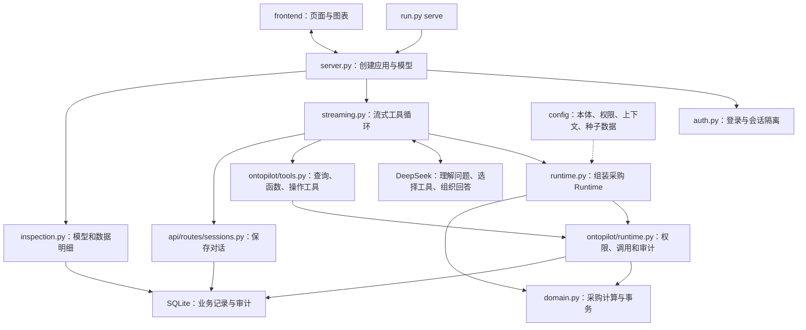

# 采购 Demo 代码阅读图

本文只说明当前独立采购项目。安装启动见 [README](README.md)，页面和角色权限见 [功能说明](features.md)。以下文件路径均相对于本目录。

## 从哪里开始读

| 顺序 | 文件 | 主要看什么 |
|---|---|---|
| 1 | [domain.py](domain.py) | 延期影响、报价比较、金额汇总、审批和执行规则 |
| 2 | [runtime.py](runtime.py) | 怎样把采购规则接入本体 Runtime |
| 3 | [本体定义](config/ontology_schema.yaml)、[教学数据](config/seed_data.yaml)、[权限](config/permissions.yaml) | 对象、关系、函数、操作以及角色权限 |
| 4 | [streaming.py](streaming.py) | AI 怎样选择工具、读取返回值、生成回答及等待确认 |
| 5 | [auth.py](auth.py) | 登录凭据、会话归属和历史标题编辑 |
| 6 | [server.py](server.py)、[run.py](run.py) | 应用装配、模型创建和启动 |
| 7 | [App.tsx](frontend/src/App.tsx) | 登录、历史切换、流式消息和页面状态 |

## 一次网页问答经过哪些代码

模型负责理解问题和选择工具；查询、金额、可行性和审批约束由程序处理。业务函数通过 `runtime.py` 注册到核心 Runtime 中，核心库通过注册表调用采购逻辑。

网页发起 `POST /api/chat/live` 后，会依次收到会话信息、执行步骤、工具返回、回答片段、图表数据和完成状态。实际处理在 `streaming.py`；兼容接口 `/api/chat` 复用相同处理逻辑，最终一次返回 JSON。

每轮开始会读取共享申请的最新状态。历史消息保存当时的结果，不代表当前申请状态；聊天顶部的状态区也会重新读取数据库。

## 本体定义与业务实现怎样对应

| 内容 | 定义或入口 | 实现 |
|---|---|---|
| 对象、属性、关系、函数和操作 | [ontology_schema.yaml](config/ontology_schema.yaml) | `SchemaRegistry` 读取，`ObjectStore` 保存与遍历 |
| 查询与计算权限、操作权限 | [permissions.yaml](config/permissions.yaml) | 核心权限检查，加上采购业务条件校验 |
| 给模型的业务上下文 | [context_sources.yaml](config/context_sources.yaml) | `runtime.py` 的 `SupplierContext` |
| 7 个采购函数 | 本体中的函数定义 | `domain.py` 的 `SupplierService`，由 `runtime.py` 注册 |
| 供货风险评分 `analyzeSupplyRisk` | 本体中的函数定义 | [ontopilot/functions.py](ontopilot/functions.py) 中的确定性规则 |
| 3 个业务操作 | 本体中的操作定义 | `runtime.py` 的 `SupplierActions` → `domain.py` |

7 个采购函数分别是 `getProcurementOverview`、`assessSupplierDelay`、`assessSupplyOption`、`compareSupplyOptions`、`traceOrderRelations`、`getChangeRequest` 和 `aggregateOrders`；加上风险评分，共 8 个函数。

3 个业务操作是 `submitSupplierChange`、`approveSupplierChange` 和 `executeSupplierChange`。采购员提交，另一位审批员批准，再由采购员执行。每一步都需要先预览、再由用户确认；确认绑定服务端保存的预览参数，数据变化后需要重新预览或重新提交审批。

## 数据放在哪里

[config/seed_data.yaml](config/seed_data.yaml) 包含初始教学数据；首次启动时导入 `.procurement-v2.db`。业务对象、对话和审计保存在这份 SQLite 的不同表中。关系主要通过对象中的关联编号表达，当前项目不需要单独的图数据库。

- [ontopilot/store.py](ontopilot/store.py)：对象记录的保存、筛选和关系遍历。
- [api/routes/sessions.py](api/routes/sessions.py)：会话、消息和待确认操作的持久化。
- [ontopilot/audit.py](ontopilot/audit.py)：操作与查询的审计记录。
- [domain.py](domain.py)：采购执行时用一个 SQLite 事务同时更新订单、报价数量、预算和申请；失败时回滚。

[build_dataset.py](build_dataset.py) 根据基础采购定义、基础教学数据和 [supplier_extension.yaml](model/supplier_extension.yaml) 生成本体定义、种子数据及 [数据清单](dataset_manifest.json)。重新生成文件不会覆盖正在使用的数据库；显式执行 `run.py reset` 才恢复初始业务数据。

## 页面从哪里改

| 页面或交互 | 文件 |
|---|---|
| 页面总状态、历史切换、取消旧请求 | [App.tsx](frontend/src/App.tsx) |
| 首页统计与问题入口 | [SupplierDemoHome.tsx](frontend/src/components/SupplierDemoHome.tsx) |
| 对话内容与输入框 | [ChatPanel.tsx](frontend/src/components/ChatPanel.tsx) |
| 读取流式事件 | [supplierStream.ts](frontend/src/supplierStream.ts) |
| 实际工具返回、聚合表格与图表 | [SupplierActivity.tsx](frontend/src/components/SupplierActivity.tsx) |
| 实时申请状态 | [SupplierRequestStatus.tsx](frontend/src/components/SupplierRequestStatus.tsx) |
| 编辑历史标题 | [SessionTitleEditor.tsx](frontend/src/components/SessionTitleEditor.tsx) |
| 本体配置、数据明细 | [SupplierOntologyPanel.tsx](frontend/src/components/SupplierOntologyPanel.tsx)、[SupplierDataPanel.tsx](frontend/src/components/SupplierDataPanel.tsx) |
| 对象类型关系图 | [OntologyGraphPanel.tsx](frontend/src/components/OntologyGraphPanel.tsx) |

前端源码直接维护在 `frontend/src`。修改后执行 `npm run build` 更新 `frontend/dist`；服务直接提供构建后的页面，不需要旧版补丁脚本或目录外源码。

## 增加业务能力时改哪些地方

| 目标 | 主要修改位置 |
|---|---|
| 增加教学记录 | `build_dataset.py`，再生成配置文件 |
| 增加对象、属性或关系 | `model/supplier_extension.yaml`，再生成并检查关联编号 |
| 增加采购函数 | 扩展定义 → `domain.py` 实现 → `runtime.py` 注册 → `config/permissions.yaml` 授权 |
| 改报价、预算或影响规则 | `domain.py` |
| 改模型获得的业务说明 | `runtime.py` 的 `SupplierContext`、配置中的函数描述及 `streaming.py` |
| 改账号和会话归属 | `auth.py`；切换页面的状态处理在 `App.tsx` |

启动时，`run.py serve` 使用 `server.py` 创建采购应用。单次命令行 `run.py chat` 使用 [ontopilot/agent.py](ontopilot/agent.py)；网页的多轮、流式和确认处理以 `streaming.py` 为准。
